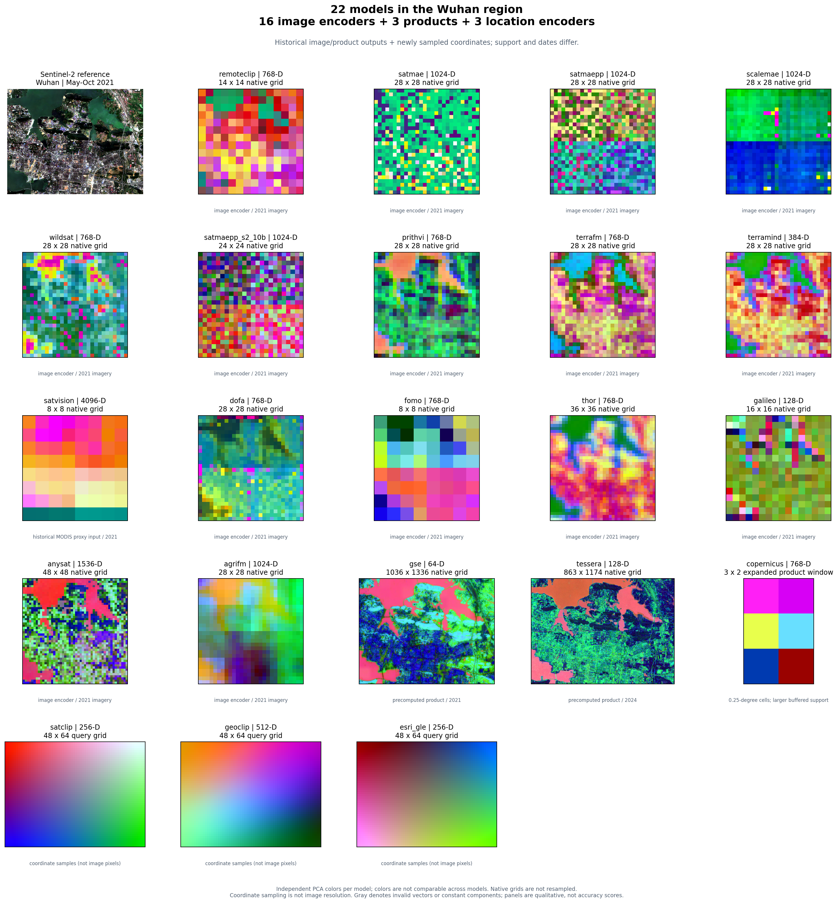
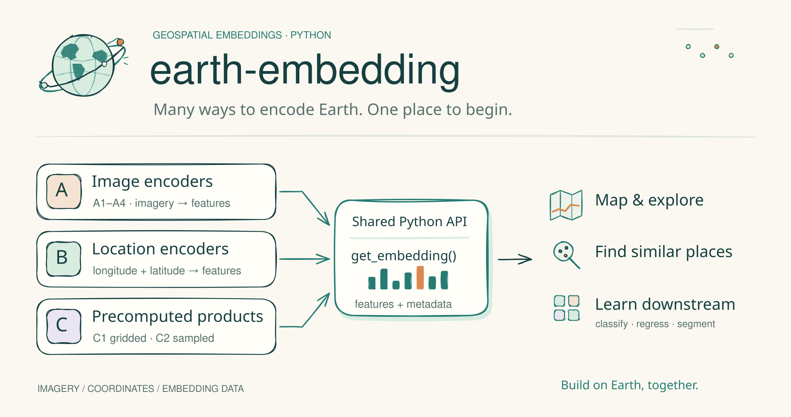
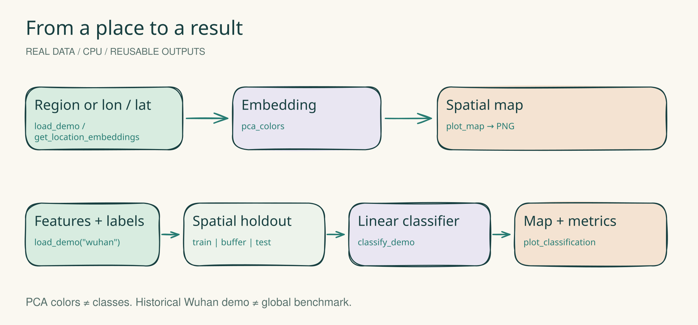
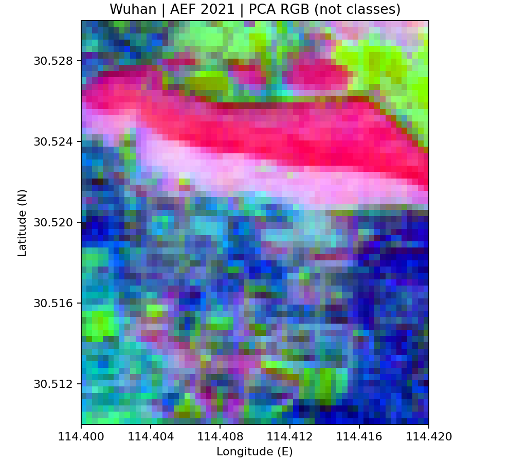
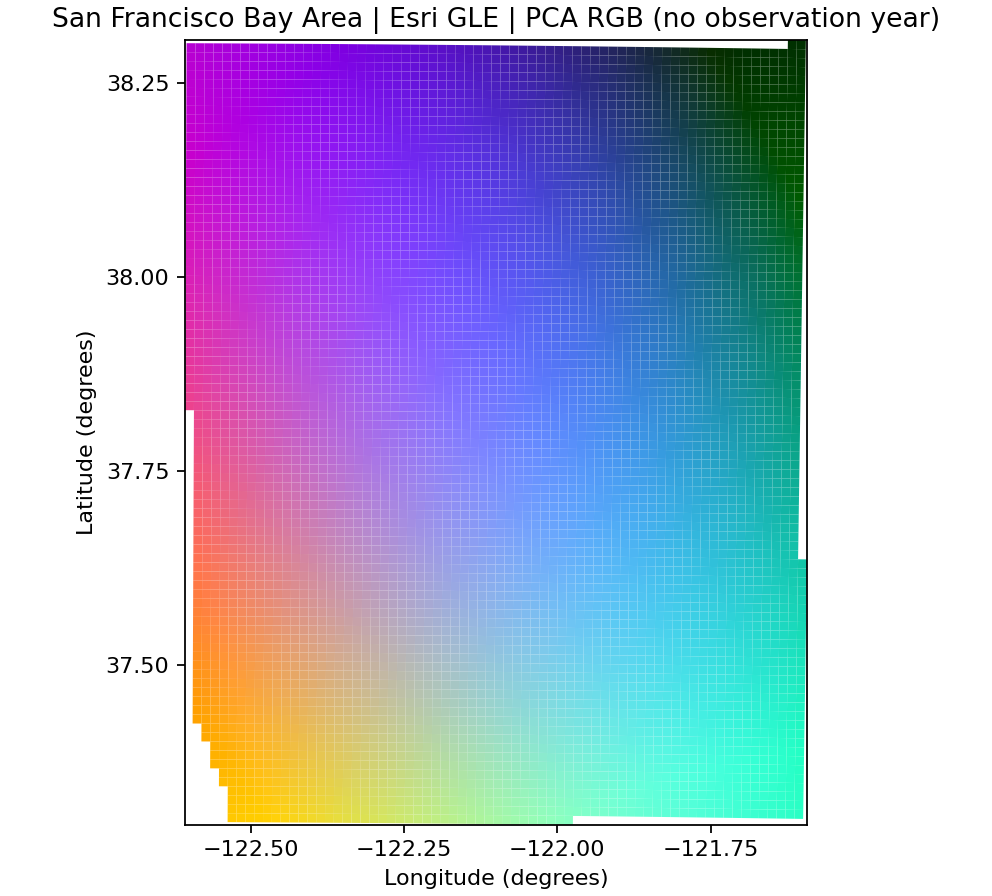
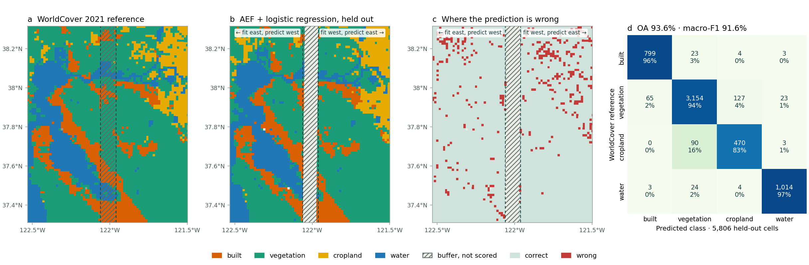

<div align="center">
  

# Earth Embedding

**衛星画像、地理的位置、事前計算済み埋め込みを共通の Python API で扱う。**

[English](README.md) · [简体中文](README.zh-CN.md) · [日本語](README.ja.md)

[](pyproject.toml)
[](LICENSE)
[](docs/models.md)
[](docs/validation.md)
[](https://github.com/GISWLH/earth-embedding/actions/workflows/tests.yml)

[インストール](#インストール) · [モデル一覧](#モデル一覧) · [ドキュメント](docs/index.md) · [検証記録](docs/validation.md) · [貢献方法](CONTRIBUTING.md)

</div>

## 同じ API で 22 モデルを比較

```python
emb = get_embedding("prithvi", spatial=spatial, temporal=temporal, output=output)
```



画像モデル、SatCLIP・GeoCLIP・Esri GLE の位置モデル、事前計算済み製品を
`compare_embeddings(...)` と `plot_embedding_comparison(...)` で一枚に表示できます。
各パネルの PCA 色と空間サポートはモデル固有であり、性能順位を示す図ではありません。

```bash
python examples/compare_models.py --models all --out outputs/comparison
python examples/compare_models.py --models satclip geoclip esri_gle --device cpu
```

[比較チュートリアル](docs/tutorials/model-comparison.md) ·
[Notebook](examples/notebooks/05_compare_models.ipynb) ·
[Hugging Face・公式リソース](docs/model-resources.md)

> **開発の経緯。** Earth Embedding は、Dingqi Ye 氏とコントリビューターによる [CyberGIS rs-embed](https://github.com/cybergis/rs-embed) を基にした、独立して保守される拡張プロジェクトです。Apache-2.0 ライセンスと原著者の表記を維持し、元の API、アダプター、実装基盤を継承しています。[元の rs-embed 論文](https://arxiv.org/abs/2602.23678)と本プロジェクトの研究原稿は別の成果です。[来歴と謝辞](docs/provenance.md)をご覧ください。

<picture>
  <source media="(max-width: 760px)" srcset="docs/assets/earth-embedding-hero-mobile.svg">
  
</picture>

<!-- REAL_DEMOS_START -->
## 5 行で最初の実データ地図を作る

Python 3.12 以降、CPU で実行できます。この Git リポジトリからインストールし、PyPI 公開は前提にしません。小さな実データを同梱し、読み込み時に SHA-256 を検証します。Earth Engine 認証や個人環境のパスは不要です。

```bash
git clone https://github.com/GISWLH/earth-embedding.git
cd earth-embedding
python -m pip install -e ".[demo,aef]"
```


<picture>
  <source media="(max-width: 760px)" srcset="docs/assets/earth-embedding-demos-mobile.svg">
  
</picture>


### 1. AEF 2021 → PCA マップ

```python
from earth_embedding.demo import load_demo, pca_colors, plot_map
data = load_demo("aef")
colors = pca_colors(data.features)
fig = plot_map(data.samples, colors, title="San Francisco Bay Area | AEF 2021 | PCA RGB")
fig.savefig("aef-pca.png", dpi=160)
```




サンフランシスコ湾岸と周辺、西経 122.6–121.6° / 北緯 37.3–38.3°、約 **88 × 111 km**。Google / Google DeepMind AEF 2021 の **1,280 m** オーバービューから 5,933 セルを同梱しています。検証付きデータは約 2.1 MB です。RGB は記述的な主成分であり、**土地被覆クラスではありません**。[取得方法とライセンス](docs/tutorials/real-demos.md)。公式 GCS を再取得する場合は `earth_embedding.demo` の `fetch_aef_demo()` を使用します。上の例はオフラインで動作します。

### 2. Esri GLE → 位置の埋め込みマップ

```python
from earth_embedding import get_location_embeddings
from earth_embedding.demo import load_demo, pca_colors, plot_map
data = load_demo("bayarea")
points = data.samples[["center_lon", "center_lat"]].to_numpy()
gle = get_location_embeddings("esri_gle", points, device="cpu", batch_size=128)
fig = plot_map(data.samples, pca_colors(gle.data), title="San Francisco Bay Area | Esri GLE | PCA RGB")
fig.savefig("esri-gle-pca.png", dpi=160)
```




湾岸の 5,933 地点をバッチ処理します。初回のみ約 3.7 MB の公式重みを取得し、PyTorch で直接推論します。ArcGIS/ArcPy は不要です。GLE に**観測年はなく**、色は位置の事前表現であり、特定年の土地被覆図ではありません。

### 3. 埋め込み + ラベル → 分類

```python
from earth_embedding.demo import classify_demo, plot_classification
result = classify_demo()
print({k: result["metrics"][k] for k in ("oa", "macro_f1", "balanced_accuracy")})
fig = plot_classification(result)
fig.savefig("bayarea-classification.png", dpi=160)
```



| OA | Macro-F1 | Balanced Accuracy | Train / test / buffer / excluded |
| ---: | ---: | ---: | --- |
| 91.39% | 87.49% | 85.65% | 3383 / 2173 / 375 / 2 |


今回実行した地域データの**ソフトウェア実演**であり、論文の全球結果ではありません。建物域・植生・農地・水域の 4 クラス。南部を学習、北部をテストとし、約 5.5 km 以上の間隔を設け、裸地 2 セルを除外します。学習用の農地は 9 セルしかなく、固定した空間分割にはクラス不均衡があります。標準化とロジスティック回帰は学習データだけで推定します（seed 42）。灰色部分は評価対象外です。[クラス数・出典・分割・制約](docs/tutorials/real-demos.md)。

### 実行済みの 4 つの Notebook

[01 · AEF](examples/notebooks/01_first_embedding_map.ipynb) ·
[02 · Esri GLE](examples/notebooks/02_esri_locations.ipynb) ·
[03 · Classification](examples/notebooks/03_regional_classification.ipynb) ·
[04 · Export / reuse](examples/notebooks/04_export_and_reuse.ipynb)


実際の出力と地図を保存しています。[実行記録](docs/validation/demo-notebooks.json) · [詳細チュートリアル](docs/tutorials/real-demos.md) · [編集可能な Excalidraw](docs/assets/earth-embedding-demos.excalidraw)。04 は分割出力と ID による再利用を扱い、空間的な支持範囲が異なる製品の順位付けは行いません。
<!-- REAL_DEMOS_END -->


## Earth Embedding でできること

リモートセンシングのモデルは、入力バンド、前処理、空間的な支持範囲、時系列、データ取得方法が異なります。Earth Embedding は、それらの違いを明示したまま、特徴量を取得する共通インターフェースを提供します。画像、経緯度の配列、事前計算済みプロダクトから、下流タスクに使える埋め込みと来歴メタデータを取得できます。

- **3 種類の入り口：**利用者に提供されるオブジェクトに基づき、画像エンコーダー、位置エンコーダー、事前計算済み埋め込みプロダクトを区別します。
- **22 の登録アダプター：**画像の 16 構成、位置エンコーダー 3 種、事前計算済みプロダクト 3 種。任意依存の統合も含むため、実行状況は検証記録で確認してください。
- **位置だけから推論：**SatCLIP、GeoCLIP、Esri Global Location Encoder を、共通の `[経度, 緯度]` 入力で扱います。Esri の軽量な重みは PyTorch で直接実行します。
- **AlphaEarth への直接アクセス：**Google 公式 Cloud Storage のタイルを検索し、Earth Engine 認証なしで 64 次元ベクトルを取得します。
- **再利用しやすい出力：**プーリング済みベクトル、対応モデルの空間グリッド、バッチ抽出、エクスポート、モデルとデータのメタデータ。
- **研究との接続：**公開形態に基づく分類、全球評価設計、武漢の診断を、ソフトウェアの動作検証と区別して説明します。

新しい入り口は `import earth_embedding` と `earth-embedding` コマンドです。既存の `rs_embed` インポートと `rs-embed` コマンドも互換性のために利用できます。

## インストール

Python 3.12 以降を使用してください。現在は Git リポジトリからインストールします。以下は PyPI に同名パッケージが公開済みであることを前提としません。

```bash
python -m pip install "earth-embedding @ git+https://github.com/GISWLH/earth-embedding.git"
```

任意機能の利用や開発には、ソースを取得します。

```bash
git clone https://github.com/GISWLH/earth-embedding.git
cd earth-embedding
python -m pip install -e ".[location,aef]"
```

| 追加依存 / 環境 | 用途 |
| --- | --- |
| 基本インストール | コア API と `pyproject.toml` に定義された依存関係 |
| `.[location]` | GeoCLIP の公式 Python パッケージ。SatCLIP と Esri GLE は同梱の実装を使用 |
| `.[aef]` | Rasterio / PyArrow による AEF COG と Parquet インデックスの読み込み |
| `.[benchmark]` | 空間ホールドアウト評価の例で使う Scikit-learn など |
| `.[terratorch]` | TerraMind 用の TerraTorch。Prithvi は同梱ランタイムを使用 |
| `.[dev,full,location,aef,benchmark]` | 開発用チェックとこれらの任意統合 |

PyTorch はハードウェアに合うものを用意してください。初回実行時には重みのダウンロードが発生する場合があり、大きなモデルには十分なメモリが必要です。次の一覧・説明コマンドは推論を実行しません。

```bash
earth-embedding models --json
earth-embedding describe satclip
```

Earth Engine を使う画像・プロダクト取得には `earthengine authenticate` と、利用資格のある Cloud プロジェクトの設定が必要です。必要に応じて `EE_PROJECT` を設定してください。以下の位置推論と GCS 直接取得は Earth Engine を初期化しません。

## 3 つのクイックスタート

### 1. 経緯度から埋め込みを取得

画像の取得や日付の指定は不要です。座標は WGS84 の度単位で、順序は **`[経度, 緯度]`** です。1 地点の場合も二重の配列で渡します。

```python
from earth_embedding import get_location_embeddings

locations = [[-122.42, 37.77], [139.76, 35.68], [-0.12, 51.51]]
result = get_location_embeddings("satclip", locations, device="cpu")
print(result.data.shape)  # (3, 256)
print(result.meta)

# 初回に約 3.7 MB の Esri 公式モデルをダウンロードしてキャッシュ。
esri = get_location_embeddings("esri_gle", locations, device="cpu")
print(esri.data.shape)  # (3, 256)

# .[location] を先にインストール。GeoCLIP は各地点を 512 次元で表現。
geoclip = get_location_embeddings("geoclip", locations, device="cpu")
```

Esri GLE は公式の学習済み重みを PyTorch で直接読み込みます。ArcGIS や ArcPy のインストールは不要です。ダウンロードには固定 SHA-256 による検証を行い、ローカルの `.dlpk` または `satclip.pth` を指定すればオフラインでも利用できます。Esri のモデル利用条件は別途適用されます。[Esri GLE 設定](docs/models/esri_gle.md)と[検証記録](docs/validation.md)を確認してください。

位置埋め込みは学習済みの地理的な事前情報を表します。同じ地点で年を変えても、新しい地表観測が得られるわけではありません。

### 2. 場所と期間から画像埋め込みを取得

地理的な問い合わせ API は、設定された画像を取得してモデルを実行します。この例には Earth Engine へのアクセス、モデル重み、必要な実行時依存が必要です。

```python
from earth_embedding import PointBuffer, TemporalSpec, OutputSpec, get_embedding

result = get_embedding(
    "remoteclip",
    spatial=PointBuffer(lon=-122.42, lat=37.77, buffer_m=320),
    temporal=TemporalSpec.range("2021-05-01", "2021-10-31"),
    output=OutputSpec.pooled(),
    device="cpu",
)
print(result.data.shape)
print(result.meta)
```

すでに画像がある場合は `get_image_embedding(model, pixels, spatial=..., temporal=..., sensor=..., device=...)` に CHW または TCHW 配列を渡し、画像を再取得せずに処理できます。バンド順序、センサーの数値単位、時系列の要件を満たす必要があります。任意の RGB 配列をすべてのモデルに使うことはできません。[API](docs/api.md)と[モデル別説明](docs/models.md)を参照してください。

### 3. Google Cloud Storage から AlphaEarth を直接取得

公式の全球フットプリントインデックスを一度ダウンロードし、年と領域で候補を絞ります。比較的小さい Parquet 形式を推奨します。ダウンロード前にサイズを確認できます。

```bash
curl -L -o aef_index.parquet https://storage.googleapis.com/alphaearth_foundations/satellite_embedding/v1/annual/aef_index.parquet
```

```python
from earth_embedding import BBox, find_aef_tiles, sample_aef

tiles = find_aef_tiles(
    "aef_index.parquet",
    spatial=BBox(-122.43, 37.76, -122.41, 37.78),
    year=2021,
)
result = sample_aef([[-122.42, 37.77]], tiles=tiles)
print(result.data.shape)  # (1, 64)
print(result.meta["source_for_point"])
```

サンプラーは CRS 変換、COG のバイト範囲読み込み、符号付き int8 の逆量子化、欠損値処理を行います。候補タイルは同じ年にそろえてください。未被覆・マスク地点は既定でエラーとなり、`strict=False` ではその行を NaN として保持します。ネットワーク障害はエラーとして通知します。

Google の[公式 GCS ガイド](https://developers.google.com/earth-engine/guides/aef_on_gcs_readme)では、2026 年 7 月以降は提供者負担のアクセスとされ、現在の年次データは 2017～2025 年を含みます。ほかのインデックス形式、オブジェクト一覧、Earth Engine 経由の取得、必要な出典表記は[データアクセス](docs/data-access.md)をご覧ください。本プロジェクトは AEF モデル重みを配布しません。

## モデル一覧

分類は公開されるオブジェクトと、評価対象構成の入力契約に基づきます。アーキテクチャ、解像度、学習信号、比較への適格性は別の属性です。登録は統合インターフェースの存在を示し、現在のデータ・重みへのアクセスや各環境での動作を保証するものではありません。

| 分類 | モデル ID | モデル / 公開物 | 入力・アクセス |
| --- | --- | --- | --- |
| A1 · RGB | `remoteclip` | [RemoteCLIP](docs/models/remoteclip.md) | 3 チャンネル光学画像 |
| A1 · RGB | `satmae` | [SatMAE](docs/models/satmae.md) | RGB 構成 |
| A1 · RGB | `satmaepp` | [SatMAE++](docs/models/satmaepp.md) | RGB 構成 |
| A1 · RGB | `scalemae` | [Scale-MAE](docs/models/scalemae.md) | RGB と空間スケール |
| A1 · RGB | `wildsat` | [WildSAT](docs/models/wildsat.md) | RGB。バックボーンは構成に依存 |
| A2 · 固定スキーマ | `satmaepp_s2_10b` | [SatMAE++ Sentinel-2](docs/models/satmaepp.md) | 指定順序の 10 バンド |
| A2 · 固定スキーマ | `prithvi` | [Prithvi-EO-2.0](docs/models/prithvi.md) | 現在のアダプターの 6 バンド入力 |
| A2 · 固定スキーマ | `terramind` | [TerraMind](docs/models/terramind.md) | 現在の構成は Sentinel-2 経路 |
| A2 · 固定スキーマ | `terrafm` | [TerraFM](docs/models/terrafm.md) | 現在の構成は Sentinel-2 経路 |
| A2 · 固定スキーマ | `satvision` | [SatVision-TOA](docs/models/satvision.md) | 14 チャンネル MODIS TOA。粗い空間支持 |
| A3 · チャンネル適応 | `dofa` | [DOFA](docs/models/dofa.md) | スペクトルチャンネルと波長 |
| A3 · チャンネル適応 | `fomo` | [FoMo](docs/models/fomo.md) | モデル固有のチャンネル識別子 |
| A3 · チャンネル適応 | `thor` | [THOR](docs/models/thor.md) | モデル固有のバンド・スキーマ情報 |
| A4 · 多時期 | `galileo` | [Galileo](docs/models/galileo.md) | 日付付き Sentinel-2 系列 |
| A4 · 多時期 | `anysat` | [AnySat](docs/models/anysat.md) | 日付付き Sentinel-2 系列 |
| A4 · 多時期 | `agrifm` | [AgriFM](docs/models/agrifm.md) | 日付付き Sentinel-2 系列 |
| B · 位置 | `satclip` | [SatCLIP](docs/models/satclip.md) | 経緯度、256 次元 |
| B · 位置 | `geoclip` | [GeoCLIP](docs/models/geoclip.md) | 経緯度、512 次元。任意パッケージが必要 |
| B · 位置 | `esri_gle` | [Esri Global Location Encoder](docs/models/esri_gle.md) | 経緯度、256 次元。PyTorch で直接推論、約 3.7 MB のダウンロード |
| C1 · グリッド製品 | `gse` | [Google Satellite Embedding / AEF](docs/models/gse.md) | 10 m 年次製品、64 次元。GEE または別の GCS 補助 API |
| C1 · グリッド製品 | `tessera` | [TESSERA](docs/models/tessera.md) | 10 m 年次製品。GeoTessera 経由またはキャッシュ |
| C1 · グリッド製品 | `copernicus` | [Copernicus-Embed-025deg](docs/models/copernicus.md) | 事前計算済み 0.25° グリッド |

分類体系には **C2 サンプリング型埋め込みコレクション**も含まれますが、現在の 22 項目に C2 アダプターの実装を含むとは主張していません。同じモデル系列でも、重みと事前計算済み製品は異なる分類になり得ます。

## 再利用できるワークフロー

| 段階 | API | 確認事項 |
| --- | --- | --- |
| モデルの選択 | `models --json`、`describe MODEL` | 入力要件、対応出力、任意依存 |
| 画像の確認 | `inspect_provider_patch(...)` | 被覆、バンド、値、形状、観測期間 |
| 画像特徴量 | `get_embedding(...)`、`get_image_embedding(...)` | プロバイダー経由かローカルか、前処理 |
| 位置特徴量 | `get_location_embeddings(...)` | WGS84 の経緯度順、重み、デバイス |
| AEF の取得 | `find_aef_tiles(...)`、`sample_aef(...)` | 年、被覆、CRS、欠損値、取得元 |
| 大量抽出 | `get_embeddings_batch(...)`、`export_batch(...)` | 構成の統一、キャッシュ、メタデータ、失敗記録 |
| 下流評価 | 任意の推定器と空間分割 | ラベル、漏洩、支持範囲の整合、不確実性 |

結果の `.data` と `.meta` は一緒に保存してください。特徴次元や空間グリッドの対応はモデルごとに異なり、共通 API によって別モデルのベクトルが交換可能になるわけではありません。

## 応用と実行可能な評価例

土地被覆分類、建物・植生・水域の面積比率回帰、密な出力が利用できる場合の水域セグメンテーション、同じ埋め込み空間内の類似検索、位置事前情報のベースラインに利用できます。年次製品では同じ領域を複数年で問い合わせられます。これらは特徴量から構築する下流タスクであり、全モデルに学習済み予測ヘッドが付属するという意味ではありません。

[評価スクリプト](examples/evaluate_embeddings.py)は保存済み特徴量を使います。メタデータ CSV には `sample_id,target,split,spatial_group`、各 NPZ には `X` と `sample_id` が必要です。`split` は `train` / `test` とし、両者の空間グループを重複させないでください。

```bash
python -m pip install -e ".[benchmark]"
python examples/evaluate_embeddings.py --metadata metadata.csv --features satclip=satclip.npz geoclip=geoclip.npz --task classification --out evaluation.json
```

全モデルに共通する有効なサンプルを ID で整列し、標準化と線形モデルは訓練データだけで学習します。サンプルと入力のハッシュも記録します。回帰には `--task regression` を指定します。空間分割は利用者が定義する必要があり、この例は論文の最終スコアを再現するものではありません。

## 研究原稿とソフトウェアの関係

研究原稿の作業から、公開形態の分類、比較可能な入力・出力契約、評価の来歴記録をソフトウェアに取り込んでいます。固定済みの論文ベンチマークは **20 システム：A16 + B1（SatCLIP）+ C3** です。ソフトウェアは GeoCLIP と Esri GLE の追加統合によって **22 アダプター**になっていますが、論文の評価対象が自動的に増えるわけではありません。

改訂後の主評価は、全球に分布する **640 m** の空間単位を使います。武漢の **567 / 2,173 タイル**資料は、それぞれの地域的・歴史的な診断範囲を維持し、全球評価の代替にはしません。分類、比率回帰、適格な密出力タスクでは、空間ホールドアウトと支持範囲の整合が重要です。SatVision と Copernicus-Embed は、特定の統制比較に不適格な場合でも分類自体は変わりません。

詳しくは[研究範囲と証拠の境界](docs/research.md)を参照してください。原稿は作業中であり、RSE への採択、最終ランキング、スモークテストによる科学的優位性を主張するものではありません。

## 検証状況と制約

[検証記録](docs/validation.md)は単体テスト、実モデル推論、オンライン取得を区別しています。[湾岸の統合検証](docs/validation/demo-live.json)で地域 AEF サンプルと README の 3 例を検証し、[Notebook 実行](docs/validation/demo-notebooks.json)と[空間ホールドアウト指標](docs/assets/demos/classification-metrics.json)を別々に記録します。

データ提供者によって認証、クォータ、利用条件への同意が必要な場合があります。一部モデルには専用環境や大きな重みが必要です。Esri GLE の重みには Esri のモデル利用条件が適用されます。位置エンコーダーは時系列観測を持ちません。粗い製品を再サンプリングしても 10 m の製品と同等にはなりません。比較設計の前に[制約](docs/limitations.md)を確認してください。

## ドキュメント案内

| 入門 | 詳細 |
| --- | --- |
| [クイックスタート](docs/quickstart.md) | [API リファレンス](docs/api.md) |
| [モデル一覧](docs/models.md) | [入力と出力の概念](docs/concepts.md) |
| [AlphaEarth データ取得](docs/data-access.md) | [抽出ワークフロー](docs/workflows.md) |
| [研究範囲](docs/research.md) | [検証記録](docs/validation.md) |
| [例と Notebook](examples/) | [アダプターの追加](docs/extending.md) |
| [プロジェクトの来歴](docs/provenance.md) | [変更履歴](CHANGELOG.md) |

ヘッダー画像とロゴは、編集可能な Excalidraw の手描き要素で作成しています。元ファイル、SVG、PNG と再生成方法は[アートワークガイド](docs/assets/earth-embedding-brand.md)をご覧ください。

## コントリビューション

入力契約が明確なモデル統合、再現可能な不具合報告、実行可能な例、データ取得の修正、英語・中国語・日本語の文書改善を歓迎します。[CONTRIBUTING.md](CONTRIBUTING.md)を読み、[Issue](https://github.com/GISWLH/earth-embedding/issues)には公式ソース、ライセンス、重み、具体的な用途を添えてください。

今後の方向には、環境検証の拡充、利用者の画像を使う再現可能な例、事前計算済み製品の取得方法の追加、十分に文書化された C2 統合があります。これらは開発の方向であり、実装済み機能の一覧ではありません。

## 引用・謝辞・ライセンス

本拡張を引用する際は、リポジトリ URL と実際に使用したコミットまたはリリースを記載してください。[CITATION.cff](CITATION.cff)に機械可読な情報があります。元のフレームワークを使う場合は rs-embed 論文を引用し、使用したモデルとデータの原著も引用してください。本プロジェクトの研究原稿には、公開された書誌情報が得られた時点で別の引用を追加します。

```bibtex
@article{ye2026modelplacetimeremote,
  title={Any Model, Any Place, Any Time: Get Remote Sensing Foundation Model Embeddings On Demand},
  author={Ye, Dingqi and Kiv, Daniel and Hu, Wei and Shi, Jimeng and Wang, Shaowen},
  year={2026},
  eprint={2602.23678},
  archivePrefix={arXiv},
  url={https://arxiv.org/abs/2602.23678}
}
```

rs-embed の貢献者、各モデルの著者、Google Earth Engine、Google / Google DeepMind、TorchGeo、GeoTessera、TerraTorch、rshf、Microsoft SatCLIP、GeoCLIP、Esri、地球観測コミュニティに感謝します。統合は各組織による推薦を意味しません。

ライブラリのコードは [Apache-2.0](LICENSE) で公開し、[NOTICE](NOTICE)に元の帰属を保持します。外部コード、モデル重み、データ、フォントには、それぞれのライセンスが適用されます。AlphaEarth データは CC-BY-4.0、Esri ソフトウェア・モデルは独自の条件に従います。[来歴とライセンス](docs/provenance.md)も参照してください。
