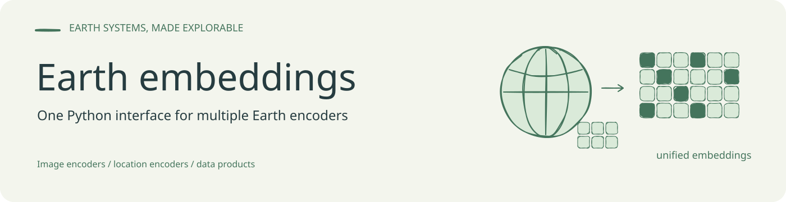

<!-- readme-visual-refresh:banner -->

<!-- /readme-visual-refresh:banner -->

<div align="center">
  

# Earth Embedding

**A shared Python interface for Earth observation images, locations, and embedding products.**

[English](README.md) · [简体中文](README.zh-CN.md) · [日本語](README.ja.md)

[](pyproject.toml)
[](LICENSE)
[](docs/models.md)
[](docs/validation.md)
[](https://github.com/GISWLH/earth-embedding/actions/workflows/tests.yml)
[](docs/model-resources.md)
[](https://giswlh.github.io/earth-embedding/)

[Quickstart](#one-call-any-model) · [Compare 22 models](#22-models-one-figure) · [Hugging Face & resources](docs/model-resources.md) · [Notebooks](examples/notebooks/) · [Docs](https://giswlh.github.io/earth-embedding/) · [Contribute](CONTRIBUTING.md)

</div>

## One call, any model

```python
emb = get_embedding("prithvi", spatial=spatial, temporal=temporal, output=output)
```

Choose a place, a time window, and an output. Swap the model name to explore
**16 image configurations, 3 location encoders, and 3 precomputed products**.
The familiar [rs-embed](https://github.com/cybergis/rs-embed) geographic API is
preserved; Earth Embedding adds location models, direct product access, and
multi-model comparison.

```bash
git clone https://github.com/GISWLH/earth-embedding.git
cd earth-embedding
python -m pip install -e ".[plot,location]"
# For image/product routes that use Earth Engine:
earthengine authenticate
```

```python
from earth_embedding import PointBuffer, TemporalSpec, OutputSpec, get_embedding

spatial = PointBuffer(lon=114.41, lat=30.52, buffer_m=640)
temporal = TemporalSpec.range("2021-05-01", "2021-10-31")
output = OutputSpec.grid()  # Or OutputSpec.pooled() for a feature vector.

emb = get_embedding("prithvi", spatial=spatial, temporal=temporal, output=output)

# The same geographic interface also works for Esri's location encoder.
gle = get_embedding("esri_gle", spatial=spatial, output=output, grid_step_m=80)
```

Use Python 3.12+. First use downloads the selected weights. Image routes need
their [model dependencies](docs/models.md) and imagery access; Esri GLE runs
directly in PyTorch without Earth Engine or ArcGIS. Annual products use
`TemporalSpec.year(2021)`; location encoders need no date.

## 22 models, one figure


**One region, 22 real outputs.** Image encoders, location encoders (including
Esri GLE), and precomputed products appear together. This is a qualitative
gallery: each panel uses its own PCA colors and retains its own spatial
support. Equal colors across panels do not indicate equal features or classes.
The gallery reuses verified historical Wuhan image/product outputs and adds
real location inference. [Inputs, provenance, and reproduction](docs/tutorials/model-comparison.md).
Dates differ across these archived runs; SatVision's historical proxy input and
Copernicus's coarse product window are labeled in the figure and provenance.

```python
from earth_embedding import compare_embeddings, plot_embedding_comparison

comparison = compare_embeddings(
    ["prithvi", "dofa", "remoteclip", "satclip", "geoclip", "esri_gle"],
    spatial=spatial,
    temporal=temporal,
    output=output,
    model_options={name: {"grid_step_m": 80}
                   for name in ("satclip", "geoclip", "esri_gle")},
    on_error="record",  # Keep successful panels; show each failure explicitly.
)
fig = plot_embedding_comparison(comparison, columns=3)
fig.savefig("comparison.png", dpi=180, bbox_inches="tight")
```

Set `models=None` to select the **entire 22-entry catalog**. Give annual
products a year through `model_options`; the [complete example](examples/compare_models.py)
does this for you and saves the figure, feature arrays, and a run report:

```bash
# All catalog models, one PNG. Requires their runtimes, weights and data access.
python examples/compare_models.py --models all --out outputs/comparison
# A smaller CPU run with no imagery download or Earth Engine authentication.
python examples/compare_models.py --models satclip geoclip esri_gle --device cpu
```

Results are available as `comparison.embeddings["prithvi"]`; failures are
reported in `comparison.errors`. Models run sequentially and release their
cached runtimes between requests by default. [Comparison notebook](examples/notebooks/05_compare_models.ipynb).

### Compare location encoders at global and local scales


These encoders use **longitude and latitude**, with no satellite observation
date. Their spatial patterns show learned geographic priors. Adjust the region
and sampling spacing with the same `spatial` and `grid_step_m` arguments.

> **Origin and attribution.** Earth Embedding is an independently maintained extension of [CyberGIS rs-embed](https://github.com/cybergis/rs-embed), created by Dingqi Ye and contributors. We retain its Apache-2.0 license and acknowledge its APIs, adapters, and engineering foundation. The [upstream paper](https://arxiv.org/abs/2602.23678) describes rs-embed; our manuscript and extensions are separate work. See [provenance](docs/provenance.md).

<picture>
  <source media="(max-width: 760px)" srcset="docs/assets/earth-embedding-hero-mobile.svg">
  
</picture>

<!-- REAL_DEMOS_START -->
## More runnable examples

Python 3.12+, CPU. Install from this Git repository; no PyPI release is assumed. The small real samples are bundled and SHA-256 verified. No Earth Engine login or private paths are needed.

```bash
git clone https://github.com/GISWLH/earth-embedding.git
cd earth-embedding
python -m pip install -e ".[demo,aef]"
```


<picture>
  <source media="(max-width: 760px)" srcset="docs/assets/earth-embedding-demos-mobile.svg">
  
</picture>


### 1. AEF 2021 → PCA map

```python
from earth_embedding.demo import load_demo, pca_colors, plot_map
data = load_demo("aef")
colors = pca_colors(data.features)
fig = plot_map(data.samples, colors, title="San Francisco Bay Area | AEF 2021 | PCA RGB")
fig.savefig("aef-pca.png", dpi=160)
```


San Francisco Bay Area and surroundings, 122.6–121.6° W / 37.3–38.3° N, about **88 × 111 km**. 5,933 real Google / Google DeepMind AEF 2021 overview cells at **1,280 m** support; the checked bundle is 2.1 MB. RGB shows descriptive principal components, **not land-cover classes**. Sampling and licenses: [full tutorial](docs/tutorials/real-demos.md). To repeat official GCS reads use `fetch_aef_demo()` from `earth_embedding.demo`; the first map above works offline.

### 2. Esri GLE → location map

```python
from earth_embedding import get_location_embeddings
from earth_embedding.demo import load_demo, pca_colors, plot_map
data = load_demo("bayarea")
points = data.samples[["center_lon", "center_lat"]].to_numpy()
gle = get_location_embeddings("esri_gle", points, device="cpu", batch_size=128)
fig = plot_map(data.samples, pca_colors(gle.data), title="San Francisco Bay Area | Esri GLE | PCA RGB")
fig.savefig("esri-gle-pca.png", dpi=160)
```


5,933 San Francisco Bay Area locations; official ~3.7 MB weights download once and run directly in PyTorch. No ArcGIS/ArcPy. GLE has **no observation year**; colors show a geographic prior, not a dated land-cover map.

### 3. Embeddings + labels → classification

```python
from earth_embedding.demo import classify_demo, plot_classification
result = classify_demo()
print({k: result["metrics"][k] for k in ("oa", "macro_f1", "balanced_accuracy")})
fig = plot_classification(result)
fig.savefig("bayarea-classification.png", dpi=160)
```


| OA | Macro-F1 | Balanced Accuracy | Train / test / buffer / excluded |
| ---: | ---: | ---: | --- |
| 91.39% | 87.49% | 85.65% | 3383 / 2173 / 375 / 2 |


Newly computed regional **software demo**, not current global paper results. Four classes: built, vegetation, cropland, water. South trains, north tests, with a ≥5.5 km geographic gap; two bare cells are excluded. There are only 9 cropland training cells, so class imbalance limits this fixed holdout. Scaler and Logistic Regression fit training rows only (seed 42). Gray cells are unscored. [Class counts, source/license, split, metrics and limits](docs/tutorials/real-demos.md).

### Notebooks

[01 · AEF](examples/notebooks/01_first_embedding_map.ipynb) ·
[02 · Esri GLE](examples/notebooks/02_esri_locations.ipynb) ·
[03 · Classification](examples/notebooks/03_regional_classification.ipynb) ·
[04 · Export / reuse](examples/notebooks/04_export_and_reuse.ipynb)


Notebooks 01–04 contain real execution outputs and maps. [Execution receipt](docs/validation/demo-notebooks.json) · [Complete tutorial](docs/tutorials/real-demos.md) · [Editable Excalidraw](docs/assets/earth-embedding-demos.excalidraw). Notebook 04 exports and safely reloads batches; it does not rank products with unequal spatial support. [05 · Compare models](examples/notebooks/05_compare_models.ipynb) includes executed three-model CPU comparison outputs and an optional full-catalog cell; see its [execution receipt](docs/validation/comparison-notebook.json).
<!-- REAL_DEMOS_END -->


## Why Earth Embedding?

Remote sensing models expose different inputs, preprocessing rules, spatial supports, and access methods. Earth Embedding makes those differences explicit while providing reusable interfaces for obtaining features. Start with satellite imagery, a list of locations, or an existing embedding product; receive embedding values and provenance metadata for your own analysis.

- **Three entry points:** image encoders, location encoders, and precomputed embedding products, organized by the object a user actually receives.
- **22 catalog entries:** 16 image configurations, 3 location encoders, and 3 precomputed products. The catalog includes optional integrations; consult the validation report for actual execution status.
- **Location-only inference:** SatCLIP, GeoCLIP, and Esri Global Location Encoder share a `[longitude, latitude]` interface. Esri's lightweight weights run directly in PyTorch.
- **Direct AlphaEarth data access:** discover official Google Cloud Storage tiles and sample 64-dimensional vectors without Earth Engine authentication.
- **Reusable outputs:** pooled vectors, supported spatial grids, batch extraction, export helpers, and model/source metadata.
- **Research connections:** a release-object taxonomy, globally distributed evaluation design, and Wuhan diagnostics documented separately from integration tests.

The `earth_embedding` import and `earth-embedding` command are the new entry points. Existing `rs_embed` imports and `rs-embed` commands remain available for compatibility.

## Installation

Use Python 3.12 or later. Install this project from its Git repository; the instructions below do not assume an `earth-embedding` release on PyPI.

```bash
python -m pip install "earth-embedding @ git+https://github.com/GISWLH/earth-embedding.git"
```

For optional features or development:

```bash
git clone https://github.com/GISWLH/earth-embedding.git
cd earth-embedding
python -m pip install -e ".[location,aef]"
```

| Extra / environment | When you need it |
| --- | --- |
| Base installation | Core APIs and the dependencies declared in `pyproject.toml` |
| `.[location]` | GeoCLIP's official Python package; SatCLIP and Esri GLE use bundled runtimes |
| `.[aef]` | Rasterio and PyArrow for direct AlphaEarth COG sampling and Parquet indexes |
| `.[benchmark]` | Scikit-learn for the spatial-holdout evaluation example |
| `.[terratorch]` | TerraMind's TerraTorch runtime; Prithvi uses a bundled runtime |
| `.[dev,full,location,aef,benchmark]` | Development checks and these optional integrations |

PyTorch must match your hardware. Model weights may download on first use; image encoders can require substantial memory. Neither the catalog command nor the describe command performs model inference:

```bash
earth-embedding models --json
earth-embedding describe satclip
```

For Earth Engine imagery/product routes, authorize your account with `earthengine authenticate` and configure an eligible Cloud project (`EE_PROJECT` when required). The direct location and GCS examples below do not initialize Earth Engine.

## Three quickstarts

### 1. Locations to embeddings

No image acquisition or date selection is needed. Inputs are WGS84 degrees in **longitude, latitude order**; even a single point is a two-dimensional array.

```python
from earth_embedding import get_location_embeddings

locations = [[-122.42, 37.77], [139.76, 35.68], [-0.12, 51.51]]
result = get_location_embeddings("satclip", locations, device="cpu")
print(result.data.shape)  # (3, 256)
print(result.meta)

# Esri's official ~3.7 MB model package downloads and caches on first use.
esri = get_location_embeddings("esri_gle", locations, device="cpu")
print(esri.data.shape)  # (3, 256)

# Install .[location] first; GeoCLIP returns 512 features per location.
geoclip = get_location_embeddings("geoclip", locations, device="cpu")
```

Esri GLE uses its official pretrained weights with direct PyTorch inference; ArcGIS and ArcPy are not required. Downloads are pinned by SHA-256, and a local `.dlpk` or `satclip.pth` can be supplied for offline use. Esri's model terms apply separately. See [Esri GLE setup](docs/models/esri_gle.md) and the [validation report](docs/validation.md).

Location embeddings describe a learned geographic prior. Querying the same location with a different year does not produce an observation of land-cover change.

### 2. A place and time to image embeddings

Use the geographic API to fetch the configured imagery and run an image encoder. This example needs authorized Earth Engine access, model weights, and the model's runtime dependencies.

```python
from earth_embedding import PointBuffer, TemporalSpec, OutputSpec, get_embedding

result = get_embedding(
    "remoteclip",
    spatial=PointBuffer(lon=-122.42, lat=37.77, buffer_m=320),
    temporal=TemporalSpec.range("2021-05-01", "2021-10-31"),
    output=OutputSpec.pooled(),
    device="cpu",
)
print(result.data.shape)
print(result.meta)
```

Already have imagery? `get_image_embedding(model, pixels, spatial=..., temporal=..., sensor=..., device=...)` accepts local CHW or TCHW arrays without fetching imagery. Supply the adapter's exact band order, sensor units, and time contract; an arbitrary RGB array is not valid input for every model. See [API reference](docs/api.md) and [model documentation](docs/models.md).

### 3. AlphaEarth embeddings directly from Google Cloud Storage

Download the official footprint index once, then select a year and area. The index is global; check its size before downloading.

```bash
curl -L -o aef_index.parquet https://storage.googleapis.com/alphaearth_foundations/satellite_embedding/v1/annual/aef_index.parquet
```

```python
from earth_embedding import BBox, find_aef_tiles, sample_aef

tiles = find_aef_tiles(
    "aef_index.parquet",
    spatial=BBox(-122.43, 37.76, -122.41, 37.78),
    year=2021,
)
result = sample_aef([[-122.42, 37.77]], tiles=tiles)
print(result.data.shape)  # (1, 64)
print(result.meta["source_for_point"])
```

The sampler performs CRS transformation, byte-range COG reads, signed-int8 dequantization, and nodata handling. Keep candidate tiles within one year. Missing coverage raises by default; `strict=False` preserves those rows as NaN. Network errors remain explicit errors.

Google's [official GCS guide](https://developers.google.com/earth-engine/guides/aef_on_gcs_readme) documents provider-paid access as of July 2026 and annual coverage from 2017 through 2025. See [data access](docs/data-access.md) for the CSV/GeoParquet/GeoPackage indexes, object manifest, Earth Engine alternative, and required attribution. AEF model weights are not distributed by this project.

## Model catalog

Classification follows the delivered object and evaluated input contract. Architecture, resolution, learning signal, and evaluation eligibility are separate properties. An adapter's presence is an integration statement; it is not a guarantee of current data access, checkpoint availability, or successful execution on your machine.

| Model ID / guide | Class | Current adapter input | Upstream source | Weights or product |
| --- | --- | --- | --- | --- |
| [`remoteclip`](docs/models/remoteclip.md) | A · image | Sentinel-2 RGB | [Source](https://github.com/ChenDelong1999/RemoteCLIP) | [Hugging Face model](https://huggingface.co/MVRL/remote-clip-vit-base-patch32) |
| [`satmae`](docs/models/satmae.md) | A · image | Sentinel-2 RGB | [Source](https://github.com/sustainlab-group/SatMAE) | [Hugging Face model](https://huggingface.co/MVRL/satmae-vitlarge-fmow-pretrain-800) |
| [`satmaepp`](docs/models/satmaepp.md) | A · image | Sentinel-2 RGB | [Source](https://github.com/techmn/satmae_pp) | [Hugging Face model](https://huggingface.co/MVRL/satmaepp_ViT-L_pretrain_fmow_rgb) |
| [`satmaepp_s2_10b`](docs/models/satmaepp.md) | A · image | Sentinel-2 10 bands | [Source](https://github.com/techmn/satmae_pp) | [Hugging Face model](https://huggingface.co/mubashir04/checkpoint_ViT-L_pretrain_fmow_sentinel) |
| [`scalemae`](docs/models/scalemae.md) | A · image | Sentinel-2 RGB + ground resolution | [Source](https://github.com/bair-climate-initiative/scale-mae) | [Hugging Face model](https://huggingface.co/MVRL/scalemae-vitlarge-800) |
| [`wildsat`](docs/models/wildsat.md) | A · image | Sentinel-2 RGB | [Source](https://github.com/cvl-umass/wildsat) | [official download](https://github.com/cvl-umass/wildsat#quickstart) |
| [`prithvi`](docs/models/prithvi.md) | A · image | Sentinel-2 6 bands + time/location | [Source](https://github.com/NASA-IMPACT/Prithvi-EO-2.0) | [Hugging Face model](https://huggingface.co/ibm-nasa-geospatial/Prithvi-EO-2.0-100M-TL) |
| [`terrafm`](docs/models/terrafm.md) | A · image | Sentinel-2 12 bands or Sentinel-1 VV/VH | [Source](https://github.com/mbzuai-oryx/TerraFM) | [Hugging Face model](https://huggingface.co/MBZUAI/TerraFM) |
| [`terramind`](docs/models/terramind.md) | A · image | Sentinel-2 12 bands | [Source](https://github.com/IBM/terramind) | [Hugging Face model](https://huggingface.co/ibm-esa-geospatial/TerraMind-1.0-small) |
| [`dofa`](docs/models/dofa.md) | A · image | Multispectral imagery + wavelengths | [Source](https://github.com/zhu-xlab/DOFA) | [Hugging Face model](https://huggingface.co/earthflow/DOFA) |
| [`fomo`](docs/models/fomo.md) | A · image | Sentinel-2 12 bands | [Source](https://github.com/RolnickLab/FoMo-Bench) | [official download](https://github.com/RolnickLab/FoMo-Bench#loading-pretrained-fomo-net) |
| [`thor`](docs/models/thor.md) | A · image | Sentinel-2 10 bands | [Source](https://github.com/FM4CS/THOR) | [Hugging Face model](https://huggingface.co/FM4CS/THOR-1.0-base) |
| [`satvision`](docs/models/satvision.md) | A · image | 14 calibrated TOA channels | [Source](https://github.com/nasa-nccs-hpda/pytorch-caney) | [Hugging Face model](https://huggingface.co/nasa-cisto-data-science-group/satvision-toa-giant-patch8-window8-128) |
| [`anysat`](docs/models/anysat.md) | A · image | Sentinel-2 10-band time series | [Source](https://github.com/gastruc/anysat) | [Hugging Face model](https://huggingface.co/g-astruc/AnySat) |
| [`galileo`](docs/models/galileo.md) | A · image | Sentinel-2 10-band time series | [Source](https://github.com/nasaharvest/galileo) | [Hugging Face model](https://huggingface.co/nasaharvest/galileo) |
| [`agrifm`](docs/models/agrifm.md) | A · image | Sentinel-2 10-band time series | [Source](https://github.com/flyakon/AgriFM) | [official download](https://github.com/flyakon/AgriFM#model-training) |
| [`satclip`](docs/models/satclip.md) | B · location | Longitude/latitude only | [Source](https://github.com/microsoft/satclip) | [Hugging Face model](https://huggingface.co/microsoft/SatCLIP-ViT16-L40) |
| [`geoclip`](docs/models/geoclip.md) | B · location | Longitude/latitude only | [Source](https://github.com/VicenteVivan/geo-clip) | [official download](https://github.com/VicenteVivan/geo-clip#usage-pre-trained-location-encoder) |
| [`esri_gle`](docs/models/esri_gle.md) | B · location | Longitude/latitude only | [Source](https://doc.arcgis.com/en/pretrained-models/latest/vector/introduction-to-global-location-encoder-sentinel-2-.htm) | [official download](https://www.arcgis.com/home/item.html?id=b0664ef297c04d4aaa44191cf21e07f3) |
| [`tessera`](docs/models/tessera.md) | C · product | Published GeoTessera embedding tiles | [Source](https://github.com/ucam-eo/geotessera) | [official product](https://github.com/ucam-eo/geotessera#dataset-versions-and-variants) |
| [`gse`](docs/models/gse.md) | C · product | Annual Google Satellite Embedding product | [Source](https://developers.google.com/earth-engine/datasets/catalog/GOOGLE_SATELLITE_EMBEDDING_V1_ANNUAL) | [official product](https://developers.google.com/earth-engine/datasets/catalog/GOOGLE_SATELLITE_EMBEDDING_V1_ANNUAL) |
| [`copernicus`](docs/models/copernicus.md) | C · product | 0.25-degree embedding product | [Source](https://huggingface.co/datasets/wangyi111/Copernicus-Embed-025deg) | [Hugging Face dataset](https://huggingface.co/datasets/torchgeo/copernicus_embed) |

[Checkpoint packaging, default variants and model terms](docs/model-resources.md#which-artifact-am-i-opening). These are upstream resources, not weights republished by this project.

The taxonomy also includes **C2 sampled embedding collections**. No C2 adapter is claimed in this 22-entry catalog. Model-lineage names alone do not determine a class: published weights and a precomputed product can be separate releases.

## A workflow you can reuse

| Stage | Interface | What to check |
| --- | --- | --- |
| Discover | `earth-embedding models --json`, `describe MODEL` | Input requirements, supported output, optional dependencies |
| Inspect imagery | `inspect_provider_patch(...)` | Coverage, bands, pixel values, shape, acquisition window |
| Encode images | `get_embedding(...)`, `get_image_embedding(...)` | Provider or local input; correct preprocessing |
| Encode locations | `get_location_embeddings(...)` | WGS84 `[lon, lat]`, model/checkpoint, device |
| Read AEF data | `find_aef_tiles(...)`, `sample_aef(...)` | Year, coverage, CRS, nodata, source URL |
| Scale extraction | `get_embeddings_batch(...)`, `export_batch(...)` | Consistent configuration, cache, metadata, error handling |
| Analyze | Your downstream estimator and spatial splits | Task labels, leakage, matched support, uncertainty |

Results expose `.data` and `.meta`. Persist both: a feature matrix without its model revision, coordinates, dates, and preprocessing choices is difficult to reproduce. Feature dimensions and spatial grid support vary across models; the library does not make vectors from different encoders interchangeable.

## What can you build?

- **Land-cover classifiers** using pooled tile features and spatially separated training/test regions.
- **Built-up, vegetation, and water fraction regressors** with labels aggregated to matching spatial support.
- **Water masks or segmentation experiments** where the selected model exposes suitable dense features.
- **Similarity search and retrieval** within a model's embedding space, with geographic holdouts for evaluation.
- **Location-prior baselines** that help distinguish geographic regularities from information in imagery.
- **Repeated product queries** across available annual layers, with consistent geometry and explicit time coverage.

These are downstream workflows you can implement with the features; they are not universal pretrained prediction heads supplied by every adapter.

### Evaluate saved embeddings with a spatial holdout

The [evaluation example](examples/evaluate_embeddings.py) consumes saved features without fetching imagery. Supply a metadata CSV with `sample_id,target,split,spatial_group`, and one NPZ per model containing `X` and `sample_id`. Use `train` / `test` splits whose spatial groups are disjoint.

```bash
python -m pip install -e ".[benchmark]"
python examples/evaluate_embeddings.py --metadata metadata.csv --features satclip=satclip.npz geoclip=geoclip.npz --task classification --out evaluation.json
```

The script aligns all models to the same finite cohort, fits scaling and linear estimators on training rows only, and records cohort/input hashes. For regression use `--task regression`. Define a meaningful spatial split before running it; this example does not reproduce final manuscript scores.

## From manuscript to reusable software

Our manuscript work motivates three additions to the software: an explicit release taxonomy, comparable input/output contracts, and evaluation provenance. The frozen manuscript benchmark contains **20 systems: A16 + B1 (SatCLIP) + C3**. The software catalog now has **22 adapters** because GeoCLIP and Esri GLE are additional integrations; this does not expand the paper's evaluated set automatically.

The revised main evaluation uses a globally distributed **640 m** design. Wuhan **567/2,173-tile** materials provide local and historical diagnostics and retain their own scope. Evaluation covers classification, fraction regression, and supported dense-output tasks; matched spatial support and spatial holdouts matter more than a single aggregate ranking. SatVision and Copernicus-Embed retain their taxonomy classes even where their spatial support makes them ineligible for a controlled comparison.

See [research scope and evidence boundaries](docs/research.md). The manuscript is under development; this repository does not claim an accepted RSE paper, a final leaderboard, or that a smoke test establishes scientific superiority.

## Validation and current limits

The [validation report](docs/validation.md) separates unit tests, real model inference, and live data access. The [Bay Area integration receipt](docs/validation/demo-live.json) verifies the regional AEF sample and all three README examples. [Notebook execution](docs/validation/demo-notebooks.json) and [held-out classification metrics](docs/assets/demos/classification-metrics.json) are recorded separately.

Data providers can require authentication, quotas, or terms acceptance. Some models need specialized packages or large checkpoints. Esri GLE's weights retain Esri's model terms. A location encoder has no temporal observations. Coarse products cannot be made equivalent to a 10 m field by resampling. Read [limitations](docs/limitations.md) before designing a comparison.

## Documentation and examples

| Start here | Go deeper |
| --- | --- |
| [Quickstart](docs/quickstart.md) | [API reference](docs/api.md) |
| [Model reference](docs/models.md) | [Input/output concepts](docs/concepts.md) |
| [AlphaEarth data access](docs/data-access.md) | [Extraction workflows](docs/workflows.md) |
| [Research scope](docs/research.md) | [Validation evidence](docs/validation.md) |
| [Example notebooks](examples/) | [Adding an adapter](docs/extending.md) |
| [Project provenance](docs/provenance.md) | [Changelog](CHANGELOG.md) |

The hero and logo are editable hand-drawn Excalidraw assets. See the [artwork source and rendering instructions](docs/assets/earth-embedding-brand.md).

## Contribute

Useful contributions include adapters with explicit input contracts, reproducible failure reports, small executable examples, provider-access fixes, and improvements to English, Chinese, or Japanese documentation. Start with [CONTRIBUTING.md](CONTRIBUTING.md) and [open an issue](https://github.com/GISWLH/earth-embedding/issues) with a model's official source, license, checkpoint, and a concrete use case.

Priorities include broader environment validation, reproducible user-supplied imagery examples, more precomputed-product access routes, and carefully documented C2 integrations. These are development directions, not promises of currently implemented functionality.

## Cite and acknowledge

For this extension, cite the software repository and the commit or release you used; machine-readable metadata is in [CITATION.cff](CITATION.cff). Cite the original rs-embed paper when using its framework, and the original model/data publications for the artifacts used in your analysis. Our research manuscript will receive its own citation when a public bibliographic record is available.

```bibtex
@article{ye2026modelplacetimeremote,
  title={Any Model, Any Place, Any Time: Get Remote Sensing Foundation Model Embeddings On Demand},
  author={Ye, Dingqi and Kiv, Daniel and Hu, Wei and Shi, Jimeng and Wang, Shaowen},
  year={2026},
  eprint={2602.23678},
  archivePrefix={arXiv},
  url={https://arxiv.org/abs/2602.23678}
}
```

We thank the rs-embed contributors, model authors, Google Earth Engine, Google and Google DeepMind, TorchGeo, GeoTessera, TerraTorch, rshf, Microsoft SatCLIP, GeoCLIP, Esri, and the wider Earth observation community. Integration does not imply endorsement.

## License

Library code is distributed under [Apache-2.0](LICENSE), with inherited attribution retained in [NOTICE](NOTICE). Vendored components, model weights, data, and fonts retain their respective licenses. AlphaEarth data is CC-BY-4.0; Esri's software/model terms apply separately. See [provenance and licensing](docs/provenance.md).

<!-- readme-visual-refresh:artwork-source -->
[Editable banner artwork · Excalidraw](assets/readme/banner.excalidraw)
<!-- /readme-visual-refresh:artwork-source -->
