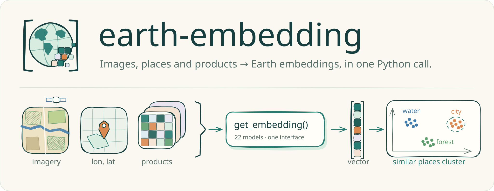
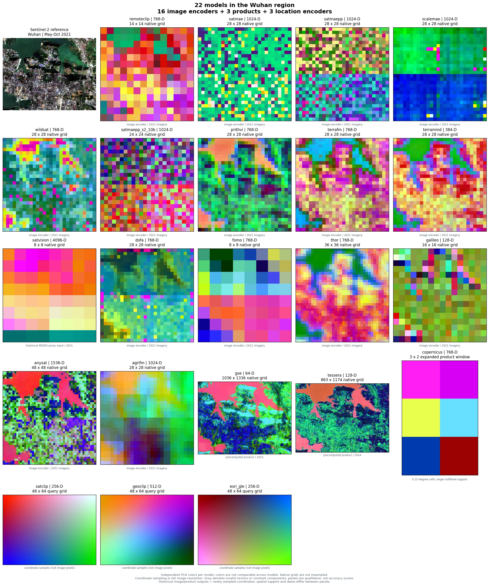
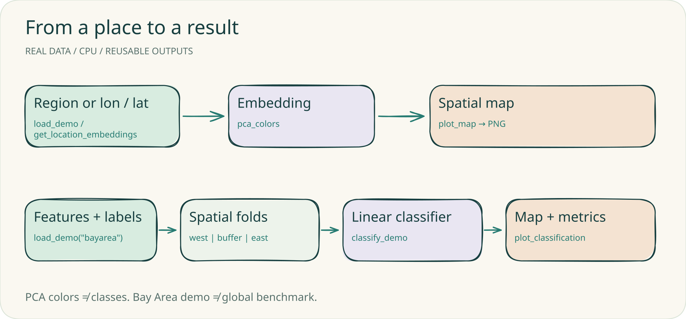
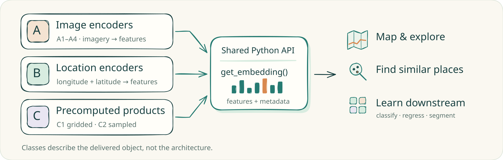

<p align="center">
  <picture>
    <source media="(max-width: 760px)" srcset="docs/assets/brand/banner-mobile.svg">
    
  </picture>
</p>

<p align="center">
  <b>English</b> · <a href="README.zh-CN.md">简体中文</a> · <a href="README.ja.md">日本語</a>
</p>

<p align="center">
  <a href="pyproject.toml"></a>
  <a href="LICENSE"></a>
  <a href="#model-catalog"></a>
  <a href="https://github.com/GISWLH/earth-embedding/actions/workflows/tests.yml"></a>
  <a href="https://giswlh.github.io/earth-embedding/"></a>
  <a href="docs/model-resources.md"></a>
</p>

<p align="center">
  <a href="#installation">Install</a> ·
  <a href="#quickstart">Quickstart</a> ·
  <a href="#gallery">Gallery</a> ·
  <a href="#real-data-tutorials">Tutorials</a> ·
  <a href="#model-catalog">Models</a> ·
  <a href="https://giswlh.github.io/earth-embedding/">Docs</a> ·
  <a href="#citation">Cite</a>
</p>

**Earth Embedding** returns embeddings, with their provenance, from three kinds of
Earth representation models through one Python interface. Choose a place, a time
window and an output, then swap the model name:

```python
from earth_embedding import PointBuffer, TemporalSpec, OutputSpec, get_embedding

spatial = PointBuffer(lon=114.41, lat=30.52, buffer_m=640)
temporal = TemporalSpec.range("2021-05-01", "2021-10-31")

emb = get_embedding("prithvi", spatial=spatial, temporal=temporal, output=OutputSpec.grid())
gle = get_embedding("esri_gle", spatial=spatial, output=OutputSpec.grid(), grid_step_m=80)
```

| Image encoders · 16 | Location encoders · 3 | Precomputed products · 3 |
| :-- | :-- | :-- |
| Imagery + time window → features. RemoteCLIP, SatMAE, Prithvi-EO-2.0, TerraMind, DOFA, THOR, Galileo, AnySat and more. | Longitude, latitude → features, on CPU and without imagery. SatCLIP, GeoCLIP, Esri GLE. | Read published embeddings. AlphaEarth / Google Satellite Embedding (also straight from GCS), TESSERA, Copernicus-Embed. |

- **One geographic API:** `get_embedding`, `compare_embeddings` and batch export share the same `spatial` / `temporal` / `output` specs.
- **Real, checked examples:** bundled SHA-256-verified Bay Area data run offline on a laptop CPU.
- **Explicit contracts:** every result carries `.data` and `.meta` (model, source, dates, preprocessing), and differences in spatial support are never hidden.
- **Compatible:** existing `rs_embed` imports and the `rs-embed` command keep working.

> **Origin.** Earth Embedding is an independently maintained extension of
> [CyberGIS rs-embed](https://github.com/cybergis/rs-embed) by Dingqi Ye and contributors,
> keeping its Apache-2.0 license, APIs and adapters. See [origin and attribution](#origin-and-attribution).

## Installation

Python 3.12+. Install from this repository (no PyPI release is assumed):

```bash
python -m pip install "earth-embedding @ git+https://github.com/GISWLH/earth-embedding.git"
```

For the tutorials, optional integrations or development, clone and add extras:

```bash
git clone https://github.com/GISWLH/earth-embedding.git
cd earth-embedding
python -m pip install -e ".[demo,location,aef]"
```

<details>
<summary><b>Optional extras</b> and Earth Engine setup</summary>

| Extra | When you need it |
| --- | --- |
| `.[demo]` | Plotting, linear probes and executing the guided notebooks |
| `.[location]` | GeoCLIP's official package; SatCLIP and Esri GLE use bundled runtimes |
| `.[aef]` | Rasterio and PyArrow for direct AlphaEarth COG sampling and Parquet indexes |
| `.[benchmark]` | Scikit-learn and SciPy for the spatial-holdout evaluation example |
| `.[terratorch]` | TerraMind's TerraTorch runtime; Prithvi uses a bundled runtime |
| `.[dev,full,location,aef,benchmark]` | Development checks and all optional integrations |

Install PyTorch for your hardware. Weights download on first use; large image
encoders need substantial memory. Inspecting the catalog runs no inference:

```bash
earth-embedding models --json
earth-embedding describe satclip
```

Image and product routes that use Earth Engine need `earthengine authenticate` and an
eligible Cloud project (`EE_PROJECT` when required). Location encoders and direct
AlphaEarth GCS sampling do not initialize Earth Engine.

</details>

## Quickstart

### Locations → embeddings

No imagery or date. Inputs are WGS84 degrees in **`[longitude, latitude]`** order.

```python
from earth_embedding import get_location_embeddings

locations = [[-122.42, 37.77], [139.76, 35.68], [-0.12, 51.51]]
satclip = get_location_embeddings("satclip", locations, device="cpu")  # (3, 256)
esri = get_location_embeddings("esri_gle", locations, device="cpu")   # (3, 256), ~3.7 MB weights
geoclip = get_location_embeddings("geoclip", locations, device="cpu") # (3, 512), needs .[location]
print(satclip.data.shape, satclip.meta)
```

Esri GLE runs its official weights directly in PyTorch: no ArcGIS or ArcPy. Downloads
are pinned by SHA-256, and a local `.dlpk` or `satclip.pth` works offline; Esri's model
terms apply ([setup](docs/models/esri_gle.md)). Location embeddings are learned
geographic priors: changing the year does not create a new observation.

### A place and a time → image embeddings

```python
from earth_embedding import PointBuffer, TemporalSpec, OutputSpec, get_embedding

result = get_embedding(
    "remoteclip",
    spatial=PointBuffer(lon=-122.42, lat=37.77, buffer_m=320),
    temporal=TemporalSpec.range("2021-05-01", "2021-10-31"),
    output=OutputSpec.pooled(),
    device="cpu",
)
print(result.data.shape, result.meta)
```

This route fetches imagery through Earth Engine and needs the model's weights and
runtime. Already have pixels? `get_image_embedding(model, pixels, spatial=..., temporal=...,
sensor=..., device=...)` accepts CHW or TCHW arrays in the adapter's exact band order and
units ([API](docs/api.md), [models](docs/models.md)).

### AlphaEarth straight from Cloud Storage

```bash
curl -L -o aef_index.parquet https://storage.googleapis.com/alphaearth_foundations/satellite_embedding/v1/annual/aef_index.parquet
```

```python
from earth_embedding import BBox, find_aef_tiles, sample_aef

tiles = find_aef_tiles("aef_index.parquet", spatial=BBox(-122.43, 37.76, -122.41, 37.78), year=2021)
result = sample_aef([[-122.42, 37.77]], tiles=tiles)
print(result.data.shape, result.meta["source_for_point"])  # (1, 64)
```

The sampler handles CRS transforms, byte-range COG reads, int8 dequantization and
no-data; missing coverage raises unless `strict=False`. Google's
[GCS guide](https://developers.google.com/earth-engine/guides/aef_on_gcs_readme) describes
provider-paid access (as of July 2026) and annual coverage for 2017–2025; see
[data access](docs/data-access.md) for indexes and the required attribution.

## Gallery

### 22 models, one region



Image encoders, location encoders and precomputed products side by side. Each panel
has its own PCA colors and keeps its native spatial support, so equal colors do not
mean equal features or classes; this is a qualitative gallery, not a ranking. Image and
product panels reuse verified historical Wuhan outputs (dates differ and are labeled);
location panels are fresh inference. [Inputs and reproduction](docs/tutorials/model-comparison.md).

```python
from earth_embedding import compare_embeddings, plot_embedding_comparison

comparison = compare_embeddings(
    ["prithvi", "dofa", "remoteclip", "satclip", "geoclip", "esri_gle"],
    spatial=spatial, temporal=temporal, output=OutputSpec.grid(),
    model_options={m: {"grid_step_m": 80} for m in ("satclip", "geoclip", "esri_gle")},
    on_error="record",  # keep successful panels; show each failure explicitly
)
plot_embedding_comparison(comparison, columns=3).savefig("comparison.png", dpi=180)
```

`models=None` selects the whole catalog. [`examples/compare_models.py`](examples/compare_models.py)
sets annual-product years for you and saves the figure, feature arrays and a run report
(`--models satclip geoclip esri_gle --device cpu` needs no imagery or Earth Engine).

### Location encoders at two scales


Location encoders see only longitude and latitude; their patterns are learned
geographic priors. Change the region and spacing with `spatial` and `grid_step_m`.

<!-- REAL_DEMOS_START -->
## Real-data tutorials

Three runnable examples on a CPU, with no Earth Engine login. They use a bundled,
SHA-256-verified **complete 72 × 88 grid** of official AlphaEarth (AEF) 2021 overview cells
at **1,280 m** over the San Francisco Bay Area (about 92 × 113 km, 6,336 cells, 2.3 MB).
Install with `python -m pip install -e ".[demo,aef]"`.

<picture>
  <source media="(max-width: 760px)" srcset="docs/assets/brand/demo-workflow-mobile.svg">
  
</picture>

**1 · AEF 2021 → PCA map** (offline)

```python
from earth_embedding.demo import load_demo, pca_colors, plot_map
data = load_demo("aef")
colors = pca_colors(data.features)
fig = plot_map(data.samples, colors, title="San Francisco Bay Area · AEF 2021 · PCA RGB")
fig.savefig("aef-pca.png", dpi=160)
```

**2 · Esri GLE → location map** (~3.7 MB weights, first run only)

```python
from earth_embedding import get_location_embeddings
from earth_embedding.demo import load_demo, pca_colors, plot_map
data = load_demo("bayarea")
points = data.samples[["center_lon", "center_lat"]].to_numpy()
gle = get_location_embeddings("esri_gle", points, device="cpu", batch_size=128)
fig = plot_map(data.samples, pca_colors(gle.data), title="San Francisco Bay Area · Esri GLE · PCA RGB")
fig.savefig("esri-gle-pca.png", dpi=160)
```

<table>
  <tr>
    <td width="50%"></td>
    <td width="50%"></td>
  </tr>
  <tr>
    <td><b>AEF 2021</b>: observation-derived embeddings; the bay, ridges, urban areas and Delta farmland separate.</td>
    <td><b>Esri GLE</b>: the same cells from coordinates alone; a smooth geographic prior with no observation year.</td>
  </tr>
</table>

RGB shows three descriptive principal components, **not land-cover classes**, and colors
are not comparable between the two maps. `fetch_aef_demo()` repeats the official GCS reads.

**3 · Embeddings + labels → held-out classification**

```python
from earth_embedding.demo import classify_demo, plot_classification
result = classify_demo()
print({k: result["metrics"][k] for k in ("oa", "macro_f1", "balanced_accuracy")})
fig = plot_classification(result)
fig.savefig("bayarea-classification.png", dpi=160)
```


| OA | Macro-F1 | Balanced accuracy | Scored / buffer / not scored |
| ---: | ---: | ---: | --- |
| 93.64% | 91.64% | 92.63% | 5,806 / 528 / 2 bare |

Two spatial folds: a model fitted only on the west half predicts the east half, and vice
versa, so every scored cell has a held-out prediction. A 7.68 km buffer is never fitted or
scored. Labels are ESA WorldCover 2021 (built, vegetation, cropland, water); the estimator
is StandardScaler + class-balanced logistic regression. This is a regional **software
demo**, not a paper benchmark. [Split, class counts, sources and limits](docs/tutorials/real-demos.md).

| Notebook | What it shows |
| --- | --- |
| [01 · First embedding map](examples/notebooks/01_first_embedding_map.ipynb) | Load the checked AEF sample and draw a PCA map |
| [02 · Esri GLE locations](examples/notebooks/02_esri_locations.ipynb) | Batch, cache and re-run a location encoder offline |
| [03 · Regional classification](examples/notebooks/03_regional_classification.ipynb) | Two-fold spatial holdout, maps and metrics |
| [04 · Export and reuse](examples/notebooks/04_export_and_reuse.ipynb) | ID-bearing batch export and safe re-alignment |
| [05 · Compare models](examples/notebooks/05_compare_models.ipynb) | Three-model CPU comparison and the full-catalog cell |

All notebooks are stored with real outputs ([execution receipt](docs/validation/demo-notebooks.json)).
<!-- REAL_DEMOS_END -->

## How it works

<picture>
  <source media="(max-width: 760px)" srcset="docs/assets/brand/how-it-works-mobile.svg">
  
</picture>

Models are organized by the object a user actually receives: **A** image encoders
(A1 RGB, A2 fixed band schema, A3 channel-adaptive, A4 multi-temporal), **B** location
encoders and **C** precomputed products (C1 gridded, C2 sampled). Architecture, resolution
and training signal are separate properties.

| Stage | Interface | What to check |
| --- | --- | --- |
| Discover | `earth-embedding models --json`, `describe MODEL` | Input requirements, outputs, optional dependencies |
| Inspect imagery | `inspect_provider_patch(...)` | Coverage, bands, values, shape, acquisition window |
| Encode images | `get_embedding(...)`, `get_image_embedding(...)` | Provider or local input; correct preprocessing |
| Encode locations | `get_location_embeddings(...)` | WGS84 `[lon, lat]`, checkpoint, device |
| Read AEF data | `find_aef_tiles(...)`, `sample_aef(...)` | Year, coverage, CRS, no-data, source URL |
| Scale up | `get_embeddings_batch(...)`, `export_batch(...)` | One configuration, cache, metadata, failures |
| Evaluate | [`examples/evaluate_embeddings.py`](examples/evaluate_embeddings.py) | Spatial splits, leakage, matched support |

Persist `.data` together with `.meta`. Feature dimensions and spatial support differ
between models; a shared interface does not make vectors from different encoders
interchangeable.

## Model catalog

| Model ID | Class | Adapter input | Upstream | Weights or product |
| --- | --- | --- | --- | --- |
| [`remoteclip`](docs/models/remoteclip.md) | A1 · image | Sentinel-2 RGB | [code](https://github.com/ChenDelong1999/RemoteCLIP) | [🤗 model](https://huggingface.co/MVRL/remote-clip-vit-base-patch32) |
| [`satmae`](docs/models/satmae.md) | A1 · image | Sentinel-2 RGB | [code](https://github.com/sustainlab-group/SatMAE) | [🤗 model](https://huggingface.co/MVRL/satmae-vitlarge-fmow-pretrain-800) |
| [`satmaepp`](docs/models/satmaepp.md) | A1 · image | Sentinel-2 RGB | [code](https://github.com/techmn/satmae_pp) | [🤗 model](https://huggingface.co/MVRL/satmaepp_ViT-L_pretrain_fmow_rgb) |
| [`scalemae`](docs/models/scalemae.md) | A1 · image | Sentinel-2 RGB + ground resolution | [code](https://github.com/bair-climate-initiative/scale-mae) | [🤗 model](https://huggingface.co/MVRL/scalemae-vitlarge-800) |
| [`wildsat`](docs/models/wildsat.md) | A1 · image | Sentinel-2 RGB | [code](https://github.com/cvl-umass/wildsat) | [official](https://github.com/cvl-umass/wildsat#quickstart) |
| [`satmaepp_s2_10b`](docs/models/satmaepp.md) | A2 · image | Sentinel-2 10 bands | [code](https://github.com/techmn/satmae_pp) | [🤗 model](https://huggingface.co/mubashir04/checkpoint_ViT-L_pretrain_fmow_sentinel) |
| [`prithvi`](docs/models/prithvi.md) | A2 · image | Sentinel-2 6 bands + time/location | [code](https://github.com/NASA-IMPACT/Prithvi-EO-2.0) | [🤗 model](https://huggingface.co/ibm-nasa-geospatial/Prithvi-EO-2.0-100M-TL) |
| [`terrafm`](docs/models/terrafm.md) | A2 · image | Sentinel-2 12 bands or Sentinel-1 VV/VH | [code](https://github.com/mbzuai-oryx/TerraFM) | [🤗 model](https://huggingface.co/MBZUAI/TerraFM) |
| [`terramind`](docs/models/terramind.md) | A2 · image | Sentinel-2 12 bands | [code](https://github.com/IBM/terramind) | [🤗 model](https://huggingface.co/ibm-esa-geospatial/TerraMind-1.0-small) |
| [`satvision`](docs/models/satvision.md) | A2 · image | 14 calibrated MODIS TOA channels | [code](https://github.com/nasa-nccs-hpda/pytorch-caney) | [🤗 model](https://huggingface.co/nasa-cisto-data-science-group/satvision-toa-giant-patch8-window8-128) |
| [`dofa`](docs/models/dofa.md) | A3 · image | Multispectral imagery + wavelengths | [code](https://github.com/zhu-xlab/DOFA) | [🤗 model](https://huggingface.co/earthflow/DOFA) |
| [`fomo`](docs/models/fomo.md) | A3 · image | Sentinel-2 12 bands | [code](https://github.com/RolnickLab/FoMo-Bench) | [official](https://github.com/RolnickLab/FoMo-Bench#loading-pretrained-fomo-net) |
| [`thor`](docs/models/thor.md) | A3 · image | Sentinel-2 10 bands | [code](https://github.com/FM4CS/THOR) | [🤗 model](https://huggingface.co/FM4CS/THOR-1.0-base) |
| [`galileo`](docs/models/galileo.md) | A4 · image | Sentinel-2 10-band time series | [code](https://github.com/nasaharvest/galileo) | [🤗 model](https://huggingface.co/nasaharvest/galileo) |
| [`anysat`](docs/models/anysat.md) | A4 · image | Sentinel-2 10-band time series | [code](https://github.com/gastruc/anysat) | [🤗 model](https://huggingface.co/g-astruc/AnySat) |
| [`agrifm`](docs/models/agrifm.md) | A4 · image | Sentinel-2 10-band time series | [code](https://github.com/flyakon/AgriFM) | [official](https://github.com/flyakon/AgriFM#model-training) |
| [`satclip`](docs/models/satclip.md) | B · location | Longitude/latitude, 256-D | [code](https://github.com/microsoft/satclip) | [🤗 model](https://huggingface.co/microsoft/SatCLIP-ViT16-L40) |
| [`geoclip`](docs/models/geoclip.md) | B · location | Longitude/latitude, 512-D | [code](https://github.com/VicenteVivan/geo-clip) | [official](https://github.com/VicenteVivan/geo-clip#usage-pre-trained-location-encoder) |
| [`esri_gle`](docs/models/esri_gle.md) | B · location | Longitude/latitude, 256-D | [docs](https://doc.arcgis.com/en/pretrained-models/latest/vector/introduction-to-global-location-encoder-sentinel-2-.htm) | [official](https://www.arcgis.com/home/item.html?id=b0664ef297c04d4aaa44191cf21e07f3) |
| [`gse`](docs/models/gse.md) | C1 · product | Annual Google Satellite Embedding, 10 m, 64-D | [catalog](https://developers.google.com/earth-engine/datasets/catalog/GOOGLE_SATELLITE_EMBEDDING_V1_ANNUAL) | [official](https://developers.google.com/earth-engine/datasets/catalog/GOOGLE_SATELLITE_EMBEDDING_V1_ANNUAL) |
| [`tessera`](docs/models/tessera.md) | C1 · product | Published GeoTessera tiles, 10 m | [code](https://github.com/ucam-eo/geotessera) | [official](https://github.com/ucam-eo/geotessera#dataset-versions-and-variants) |
| [`copernicus`](docs/models/copernicus.md) | C1 · product | 0.25° embedding grid | [source](https://huggingface.co/datasets/wangyi111/Copernicus-Embed-025deg) | [🤗 dataset](https://huggingface.co/datasets/torchgeo/copernicus_embed) |

These are upstream resources, not weights republished by this project
([packaging, default variants and terms](docs/model-resources.md#which-artifact-am-i-opening)).
An adapter is an integration, not a guarantee of data access or of execution on your
machine; see the [validation report](docs/validation.md). The taxonomy also defines
**C2 sampled collections**; no C2 adapter is claimed yet.

## Research context and limits

Our manuscript motivates the release taxonomy, comparable input/output contracts and
evaluation provenance. Its frozen benchmark has **20 systems (A16 + B1 SatCLIP + C3)**;
GeoCLIP and Esri GLE are later software integrations and do not expand that study. The
manuscript is in preparation, and this repository claims no accepted paper, final
leaderboard or scientific ranking ([research scope](docs/research.md)).

Providers may require authentication, quotas or terms; some models need large checkpoints.
A location encoder has no temporal observations, and resampling a coarse product does not
make it a 10 m field. Read the [limitations](docs/limitations.md) before designing a comparison.

## Documentation

| Start here | Go deeper |
| --- | --- |
| [Quickstart](docs/quickstart.md) | [API reference](docs/api.md) |
| [Model reference](docs/models.md) · [resources](docs/model-resources.md) | [Input/output concepts](docs/concepts.md) |
| [Real-data tutorials](docs/tutorials/real-demos.md) | [Extraction workflows](docs/workflows.md) |
| [Multi-model comparison](docs/tutorials/model-comparison.md) | [Validation evidence](docs/validation.md) |
| [AlphaEarth data access](docs/data-access.md) | [Adding an adapter](docs/extending.md) |
| [Examples](examples/) | [Changelog](CHANGELOG.md) |

## Contributing

Adapters with explicit input contracts, reproducible failure reports, small executable
examples, provider-access fixes and English, Chinese or Japanese documentation are all
welcome. Start with [CONTRIBUTING.md](CONTRIBUTING.md), or
[open an issue](https://github.com/GISWLH/earth-embedding/issues) with the model's official
source, license, checkpoint and a concrete use case. The banner, logo and diagrams are
editable Excalidraw sources ([artwork guide](docs/assets/brand/README.md)).

## Origin and attribution

Earth Embedding is an independently maintained extension of
[CyberGIS rs-embed](https://github.com/cybergis/rs-embed), created by Dingqi Ye and
contributors. We retain its Apache-2.0 license and acknowledge its APIs, adapters and
engineering foundation. The [upstream paper](https://arxiv.org/abs/2602.23678) describes
rs-embed; our manuscript and extensions are separate work ([provenance](docs/provenance.md)).

We thank the rs-embed contributors, the model and dataset authors, Google Earth Engine,
Google and Google DeepMind, TorchGeo, GeoTessera, TerraTorch, rshf, Microsoft SatCLIP,
GeoCLIP, Esri and the wider Earth observation community. Integration does not imply endorsement.

## Citation

Cite this software with the commit or release you used ([CITATION.cff](CITATION.cff)),
the original rs-embed paper when you use its framework, and the publications of the
models and data in your analysis.

```bibtex
@article{ye2026modelplacetimeremote,
  title={Any Model, Any Place, Any Time: Get Remote Sensing Foundation Model Embeddings On Demand},
  author={Ye, Dingqi and Kiv, Daniel and Hu, Wei and Shi, Jimeng and Wang, Shaowen},
  year={2026},
  eprint={2602.23678},
  archivePrefix={arXiv},
  url={https://arxiv.org/abs/2602.23678}
}
```

## License

Library code is [Apache-2.0](LICENSE), with inherited attribution in [NOTICE](NOTICE).
Vendored components, model weights, data and fonts keep their own licenses: AlphaEarth
data is CC-BY-4.0, ESA WorldCover is CC-BY-4.0, and Esri's software and model terms apply
separately. See [provenance and licensing](docs/provenance.md).
