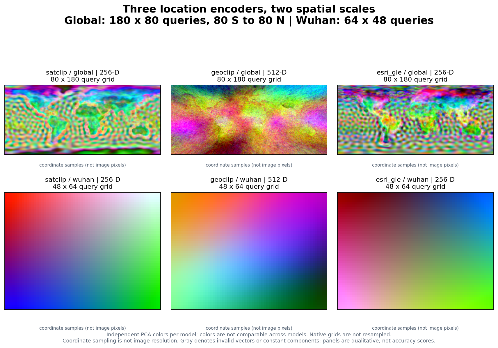

# Compare many models in one figure

Use the same `get_embedding` request for individual models, then use
`compare_embeddings` and `plot_embedding_comparison` to collect a whole model
selection into one figure. The figure retains every model's native grid and
reports failed requests explicitly.

## A real 22-model example


This gallery combines **16 image encoders, three precomputed products, and three
location encoders** for Wuhan, China. Most panels cover
`[114.35, 30.48, 114.47, 30.56]`; Copernicus shows its larger buffered product
window. Image encoders and two products use four archived feature blocks; the three location
encoders were evaluated at the same 3,072 coordinate centers for this gallery.
These are genuine model outputs. No placeholder panels or generated imagery are
used.

The archive is a **historical qualitative diagnostic**, not a new benchmark or
model ranking. It intentionally shows different spatial and temporal support:

| Panels | Input and support |
| --- | --- |
| Sentinel-2 reference and image encoders | Historical May–October 2021 imagery; model-specific bands and native feature grids |
| SatVision | Historical **MODIS proxy input**, including a reflectance/LST proxy; not a strict reproduction of its original 14-band TOA input recipe |
| Google Satellite Embedding (`gse`) | Annual 2021 product, 1,036 × 1,336 cached samples |
| Tessera | Annual **2024** product, 863 × 1,174 cached samples |
| Copernicus | One expanded 15 km buffered query of the released 0.25° product; 3 × 2 cached samples, no requested-date semantics |
| SatCLIP, GeoCLIP, Esri GLE | Longitude/latitude only; 48 × 64 coordinate queries, with no imagery or requested date |

For the image encoders, GSE, and Tessera, four neighboring blocks are arranged north to south and west to east. Each
block's stored sample orientation is retained from the historical diagnostic.
Where product blocks have unequal edge dimensions, missing edge cells are gray
padding; feature values are never interpolated to another model's grid. Some
historical encoders do not provide georeferenced token-orientation metadata, so
this figure alone cannot establish pixel-level alignment.

Copernicus's historical adjacent queries returned overlapping product cells:
20 returned vectors contained only six distinct vectors. The gallery therefore
shows one complete 3 × 2 query window rather than tiling repeated values into
a false continuous map. Its effective query bounds are approximately
`[114.2236, 30.3653, 114.5364, 30.6347]`, larger than the other Wuhan panels.

Every panel uses its own three-component PCA projection and 2nd–98th percentile
stretch. **A red feature in one panel has no shared meaning with red in another.**
Different visual texture, feature dimensions, or apparent detail do not establish
downstream accuracy. Query spacing for location encoders is sampling density,
not a claim of learned physical resolution.

[Download the full-resolution figure](../assets/comparison/all-models.png) ·
[Read the source hashes and run provenance](../assets/comparison/provenance.json)

## Start with a small selection

Install the plotting extra and each selected model's runtime. Location-only
examples need no imagery or Earth Engine authentication:

```bash
git clone https://github.com/GISWLH/earth-embedding.git
cd earth-embedding
pip install -e ".[plot,location]"
```

```python
from earth_embedding import (
    BBox, OutputSpec, compare_embeddings, plot_embedding_comparison,
)

models = ["satclip", "geoclip", "esri_gle"]
comparison = compare_embeddings(
    models,
    spatial=BBox(114.35, 30.48, 114.47, 30.56),
    output=OutputSpec.grid(),
    grid_step_m=320,  # coordinate sampling, not image resolution
    device="cpu",
)
figure = plot_embedding_comparison(
    comparison,
    columns=3,
    save_path="location-comparison.png",
)
```

`comparison.embeddings["esri_gle"]` is the original `Embedding`, including its
metadata. `comparison.summary()` reports successful shapes and errors. The
default stops at an error; set `on_error="record"` when you want the remaining
models to run and failed panels to remain visible.

## Compare the full catalog

`models=None` selects `list_models()`. Image encoders use a seasonal window,
annual products receive a year, and location encoders ignore time. A full run
requires each model's dependencies, weights, and provider access; see the
[model setup pages](../models.md).

```python
from earth_embedding import (
    BBox, OutputSpec, TemporalSpec,
    compare_embeddings, plot_embedding_comparison,
)

comparison = compare_embeddings(
    spatial=BBox(114.35, 30.48, 114.47, 30.56),
    temporal=TemporalSpec.range("2021-05-01", "2021-10-31"),
    output=OutputSpec.grid(),
    model_options={
        "gse": {"temporal": TemporalSpec.year(2021)},
        "tessera": {"temporal": TemporalSpec.year(2024)},
        "copernicus": {"temporal": TemporalSpec.year(2021)},
        "satclip": {"temporal": None, "grid_step_m": 320},
        "geoclip": {"temporal": None, "grid_step_m": 320},
        "esri_gle": {"temporal": None, "grid_step_m": 320},
    },
    on_error="record",
)
figure = plot_embedding_comparison(
    comparison,
    columns=5,
    save_path="all-models.png",
)
print(comparison.summary())
```

This is a fresh inference example; its grids and model settings need not match
the archived gallery. Tessera's year is explicit because the illustrated archive
uses 2024. Copernicus is a fixed released product and does not select a requested
acquisition date. Model-specific options remain visible in `model_options`.

The comparison helper runs models sequentially and clears model runtime caches
between requests by default. This limits accumulated weight memory while
preserving completed embeddings. Set `release_models=False` when repeated calls
should reuse loaded models. Large dense products can still occupy substantial
memory in the returned report.

For a runnable command that saves every successful feature array, metadata,
error report, and figure:

```bash
python examples/compare_models.py --models satclip geoclip esri_gle --device cpu
python examples/compare_models.py --models all --out outputs/all-models
```

The command exits nonzero for incomplete results unless `--allow-errors` is
explicitly selected. Changing the model list, region, dates, or output directory
does not require editing the plotting code.

## Location encoders at two scales



The top row evaluates **14,400 coordinate centers** on a 180 × 80 longitude /
latitude lattice spanning 180° W–180° E and 80° S–80° N. The bottom row evaluates
the Wuhan area on a 64 × 48 lattice. All three encoders receive the same
coordinates in each row. Global and local panels have independently fitted PCA
colors; they are not cross-scale color matches. The smooth local fields show
the models' coordinate-only behavior over a small geographic extent.

For a point list rather than an area, keep GIS longitude/latitude order:

```python
import numpy as np
from earth_embedding import get_location_embeddings, plot_embedding_comparison

lon, lat = np.meshgrid(np.linspace(70, 140, 80), np.linspace(5, 55, 60))
points = np.column_stack([lon.ravel(), lat.ravel()])
embeddings = {
    model: get_location_embeddings(model, points, device="cpu")
    for model in ("satclip", "geoclip", "esri_gle")
}
figure = plot_embedding_comparison(
    embeddings,
    lonlat=points,
    columns=3,
    save_path="asia-location-encoders.png",
)
```

The `(N, D)` outputs preserve input order. Supplying `lonlat` makes the plot a
spatial scatter; without coordinates it is clearly labeled as a sample strip.
See [SatCLIP](../models/satclip.md), [GeoCLIP](../models/geoclip.md), and
[Esri GLE](../models/esri_gle.md) for checkpoints, attribution, and model terms.

## Rebuild and provenance

From a checkout, this command rebuilds the two-scale location figure using real
public checkpoints, caches the computed arrays under `work/gallery-cache/`, and
records coordinate, feature, checkpoint, and image SHA-256 hashes:

```bash
python scripts/build_comparison_gallery.py --device cpu
```

The full 22-model gallery additionally needs the historical four-block feature
archive, which is **not bundled in this public repository**:

```bash
python scripts/build_comparison_gallery.py \
  --archive /path/to/part2_model_map_figure \
  --device cpu
```

The archive must include `blocks_2x/<model>/block_rXX_cXX.npz`, corresponding JSON
metadata, `manifest_2x.json`, and its Sentinel-2 reference PNG. The script reads
those inputs without modifying them. It does not redownload image data or rerun
the 19 historical image/product pipelines. Top-level Git LFS pointer files are
not used as feature arrays.

The published [provenance JSON](../assets/comparison/provenance.json) records
every source block and metadata hash, original model metadata, date differences,
runtime versions, coordinate grids, checkpoint hashes, and the exact figure
hashes. No model weights are redistributed with these illustrations.
