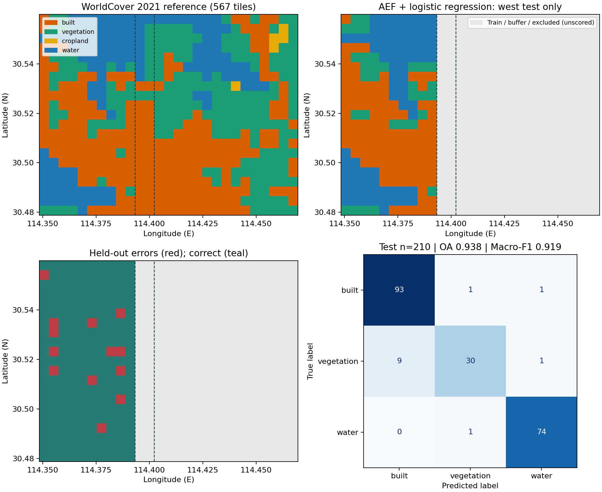

# Real embeddings, maps, and a spatial classification probe

The four guided notebooks run on CPU with public APIs and relative output paths.
The bundled **1.04 MB** of data contains real observations and reference labels,
not generated features. No weights, private server, or Earth Engine credentials
are needed for the first map or classification. Installation includes substantial
scientific/PyTorch dependencies; 1.04 MB describes the sample data, not the environment.

```bash
git clone https://github.com/GISWLH/earth-embedding.git
cd earth-embedding
python -m venv .venv
# Linux/macOS: source .venv/bin/activate
# Windows PowerShell: .venv\Scripts\Activate.ps1
python -m pip install -e ".[demo,aef]"
python examples/real_demos.py
python scripts/run_demo_notebooks.py
```

This project is installed from source; these commands do not assume a PyPI release.
The runner uses a fresh Python kernel for each notebook, fails on any cell error
or missing embedded image, and saves executed notebooks and a validation receipt.
Notebook output files go under `work/notebook-runs/*/outputs`; README figures go
under `docs/assets/demos`. In an interactive notebook, output is relative to its
working directory. Esri's initial weight download is ~3.7 MB; cached reruns are offline.

## Start with five lines

```python
from earth_embedding.demo import load_demo, pca_colors, plot_map
data = load_demo("aef")
colors = pca_colors(data.features)
fig = plot_map(data.samples, colors, title="Wuhan | AEF 2021 | PCA RGB")
fig.savefig("aef-pca.png", dpi=160)
```


`load_demo` validates each CSV/NPZ against a bundled SHA-256 manifest, rejects
duplicate or mismatched IDs, and joins features to `samples.tile_id`. Map cells
use explicit WGS84 bounds; north is up regardless of input row order. Longitude
is always the first coordinate. No PCA step is used by the classifier.

The 64 × 64 AEF sample covers `[114.40, 30.51, 114.42, 30.53]` in Wuhan.
Each approximately 30 m display cell represents its center's nearest native
10 m AEF pixel, not a cell average. Three PCA scores are stretched separately at
their 2nd and 98th percentiles. Colors are descriptive features, **not land-cover
classes**; separately fitted PCA colors are not comparable across models/areas.

To repeat the anonymous official GCS sampling rather than use the bundled copy:

```python
from earth_embedding.demo import fetch_aef_demo
fresh = fetch_aef_demo(cache_dir=".earth-embedding-cache")
cached = fetch_aef_demo(cache_dir=".earth-embedding-cache", offline=True)
```

This reuses `sample_aef` and the pinned official tile URL stored in the manifest.
It needs Rasterio (`.[aef]`). The first call reads COG byte ranges, potentially
tens of MB depending on server/GDAL block reads; transfer bytes were not metered.
The decoded array is checked against the bundled SHA-256 before atomic caching.
A changed response, network failure or corrupt cache is an error, never a silent
fallback. Cache hits recheck the array and use no network. For another area/year,
use [find_aef_tiles and sample_aef](../data-access.md) with the official index.

## Location batches and offline inference

```python
from earth_embedding import get_location_embeddings
from earth_embedding.demo import load_demo, pca_colors, plot_map
data = load_demo("wuhan")
points = data.samples[["center_lon", "center_lat"]].to_numpy()
gle = get_location_embeddings("esri_gle", points, device="cpu", batch_size=128)
fig = plot_map(data.samples, pca_colors(gle.data), title="Wuhan | Esri GLE | PCA RGB")
fig.savefig("esri-gle-pca.png", dpi=160)
```


Esri GLE runs official, pinned weights directly in PyTorch. ArcGIS and ArcPy are
not required. Its 256-dimensional vectors represent location priors: there is no
requested observation year. Notebook 02 checks batch sizes 128 and 37, explicitly
uses `local_files_only=True`, and exports features with IDs. The official weight
cache and model terms are described in the [GLE guide](../models/esri_gle.md).

## A three-class spatial probe

```python
from earth_embedding.demo import classify_demo, plot_classification
result = classify_demo()
print({k: result["metrics"][k] for k in ("oa", "macro_f1", "balanced_accuracy")})
fig = plot_classification(result)
fig.savefig("wuhan-classification.png", dpi=160)
```



This run reuses the historical Wuhan 567-tile AEF cache and WorldCover 2021 v200
labels. It is a **software demonstration**, not a reproduction of the revised
global paper benchmark. Software-added models do not enter the frozen 20-system
paper roster. The small area provides no global performance or model-ranking claim.

The historical split was stratified random, despite being stored alongside
spatial metadata. To avoid immediate train/test adjacency, this example defines
a new, fixed geographic split: east `col >= 25` trains; west `col <= 22` tests;
columns 23 and 24 are unused buffers. Five rare cropland samples are excluded
from this explicitly three-class task; they remain in the distributed data and
reference map. The split was fixed before fitting and not selected for its score.

| Partition | Built | Vegetation | Water | Cropland | Total |
| --- | ---: | ---: | ---: | ---: | ---: |
| Train | 120 | 152 | 38 | 0 | 310 |
| Test | 95 | 40 | 75 | 0 | 210 |
| Buffer | 26 | 8 | 8 | 0 | 42 |
| Rare-class exclusion | 0 | 0 | 0 | 5 | 5 |

StandardScaler and LogisticRegression (`C=1`, `max_iter=2000`, seed 42) fit only
the 310 training rows. No hyperparameter tuning, validation-label fitting or
PCA is performed. Predictions are emitted only for test cells. Gray map regions
are unscored; dashed lines enclose the buffer. The colors reuse the historical
paper plotting palette: built orange, vegetation green, cropland yellow, water blue.

| Recomputed test metric | Value |
| --- | ---: |
| OA | 0.938095 |
| Macro-F1 (three classes) | 0.919209 |
| Balanced Accuracy (mean recall) | 0.905205 |

Confusion matrix, rows reference / columns prediction, order built, vegetation, water:

```text
93   1   1
 9  30   1
 0   1  74
```

The stored [metrics](../assets/demos/classification-metrics.json) and
[ID-bearing predictions](../assets/demos/classification-predictions.csv) come from
this implementation, not copied historical paper scores. WorldCover is a
satellite-derived reference, not independent field truth. Spatial buffering
reduces adjacency but cannot remove all spatial autocorrelation or shared
satellite inputs. This one holdout has no confidence interval or rare-crop claim.

## Data selection and provenance audit

We inspected the current `paper/revision/global_benchmark/` manifest, feature
folders, target/evaluation design and result summaries. Its annual and monthly
parent cohorts (4,409 and 3,014 locations) involve target-specific eligibility,
geographic block CV and continent holdouts. Those multi-target caches and outputs
are unnecessary for a first-minute software demo and are not redistributed here.

The selected `downstream_core_2x` snapshot has 567 unique tile IDs and 19 cached
feature files. All three inspected GSE/AEF, Tessera and Copernicus caches have
finite rows and complete IDs. We select the 64-dimensional AEF file because its
provenance and redistributable data license are explicit. Merely sharing tile IDs
does not guarantee matched effective resolution across products; notebook 04
therefore demonstrates batch export/reuse instead of presenting a model ranking.
No historical imagery or complete model collection was re-downloaded or re-run.

The manifests installed under `rs_embed/data/demos/{aef,wuhan}/manifest.json`
record source URLs, year, license, attribution, field interpretation, selection,
payload sizes and SHA-256 values. The Wuhan manifest also binds the original
label CSV and original embedding NPZ hashes. The original `split` column is
preserved; generated `demo_split` controls this run.

| File / field | Meaning |
| --- | --- |
| `samples.csv: tile_id` | Stable unique key; always join on this field |
| `row`, `col` | Original grid index; row order never controls plotting |
| `center_lon`, `center_lat` | WGS84 degrees, longitude first |
| `minlon`, `minlat`, `maxlon`, `maxlat` | WGS84 cell bounds |
| `class_name`, `class_index` (Wuhan) | Grouped WorldCover reference; original index retained |
| `local_*_frac` (Wuhan) | Historical WorldCover grouped class fractions |
| `features.npz: tile_id, features` | No-pickle Unicode IDs and float32 `(N,64)` feature matrix |
| `split`, `use_for_t1` (Wuhan) | Original historical metadata, unused by new split |

Wuhan AEF features are historical arithmetic means of valid Earth Engine float
pixels per nominal-500 m tile; do not decode them as int8. Tiles derive from a
projected grid, and actual ground widths vary from nominal 500 m at Wuhan's
latitude. Crops crossing block edges retain the original historical pooling
policy. We did not regenerate their raw-pixel extraction or certify that legacy
pooling as a new benchmark protocol. The new small GCS point sample is separate,
decoded with Google's prescribed signed-int8 mapping.

Data attribution and licenses:

- AEF: The AlphaEarth Foundations Satellite Embedding dataset is produced by
  Google and Google DeepMind. [Official data guide, CC-BY-4.0](https://developers.google.com/earth-engine/guides/aef_on_gcs_readme).
- WorldCover: ESA WorldCover 10 m 2021 v200, [Zanaga et al., DOI and CC-BY-4.0](https://doi.org/10.5281/zenodo.7254221).
  Contains modified Copernicus Sentinel data (2021) processed by ESA WorldCover consortium.
- Esri weights: Esri model terms apply separately; no model weights are redistributed.

## Notebook guide and validation

| Notebook | Task | Typical CPU time after installation | First-run data / weight download |
| --- | --- | --- | --- |
| [01](https://github.com/GISWLH/earth-embedding/blob/main/examples/notebooks/01_first_embedding_map.ipynb) | Real AEF and first map | <1 minute | None; bundled sample |
| [02](https://github.com/GISWLH/earth-embedding/blob/main/examples/notebooks/02_esri_locations.ipynb) | GLE batching, caching, offline | 1–2 minutes | ~3.7 MB if cache is empty |
| [03](https://github.com/GISWLH/earth-embedding/blob/main/examples/notebooks/03_wuhan_classification.ipynb) | Spatial classification and maps | <1 minute | None |
| [04](https://github.com/GISWLH/earth-embedding/blob/main/examples/notebooks/04_export_and_reuse.ipynb) | Batch export and shuffled-ID reload | <1 minute | None |

The [execution receipt](../validation/demo-notebooks.json) records actual kernel
versions, elapsed times, embedded image counts and output file hashes.
Unit tests, real AEF reads, real GLE inference, notebook execution and downstream
scores are separate checks; one does not establish the others.

Maintainer packaging: `scripts/prepare_demo_data.py` takes the original label
CSV/feature NPZ and a downloaded official AEF index as explicit arguments.
End users never need those private workspace files. The shipped bundles suffice
to reproduce every numerical result above. `scripts/build_demo_notebooks.py`
regenerates notebook source; always execute afterwards before publishing.

## Editable workflow illustrations


Both [desktop source](../assets/earth-embedding-demos.excalidraw) and
[narrow-screen source](../assets/earth-embedding-demos-mobile.excalidraw) contain
native editable Excalidraw elements. PNG and SVG exports use the same actual
Excalidraw engine as the existing brand artwork. Rebuild with
`node scripts/render_brand.mjs --demos-only` after the tooling installation in the
[brand guide](../assets/earth-embedding-brand.md).
